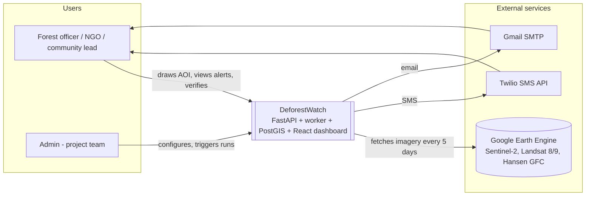
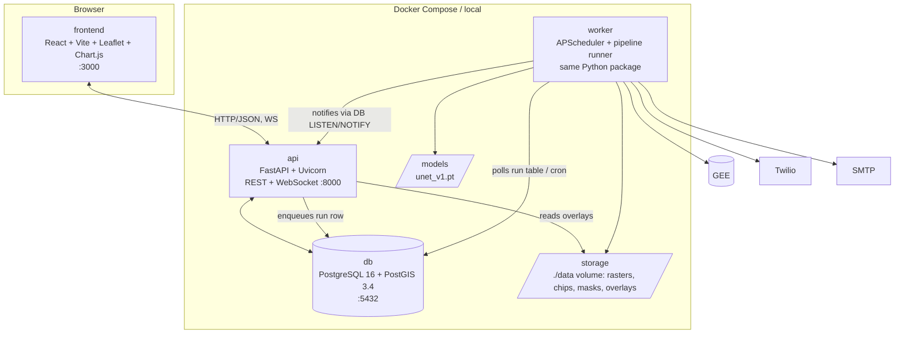

# DeforestWatch — Backend Specification and Plan of Action

**An AI-Based Deforestation Alert System Using Satellite Imagery (Hasdeo Aranya study region)**

| | |
|---|---|
| Project | DeforestWatch, Minor Project (VII semester), B.Tech CSE, BPIT, Group G1 |
| Team | Aditya, Lakshay Joshi, Shivam Singh Mahar, Avikshit Trivedi |
| Document type | Backend build specification + plan of action. Written to be handed to a developer who executes it with an AI coding agent (Claude Code, Cursor, Copilot, Windsurf). |
| Scope | **Server side only.** The frontend is specified in `03-FRONTEND-SPEC.md` and the seam between them in `01-API-CONTRACT.md`. You do not need to read either to build this. |
| Version | 1.3, 8 September 2026 — **PEKB bounding box corrected** (§3.1; the previous box missed the mine by ~14 km); localhost-only deployment; fixture ingest backend (§4.5b) |
| Stack policy | **Submitted stack only**: Google Earth Engine, PyTorch U-Net, FastAPI, PostgreSQL + PostGIS, React + Leaflet, Chart.js, Twilio. The local multi-agent design (LangGraph, Ollama, Redis, ChromaDB) is described only as a future migration path in §4.18 and MUST NOT be built now. |
| Source documents reconciled | Synopsis (PDF), Final Report (DOCX), Literature Review (PDF), Presentation (PPTX). The unsubmitted proposal (PDF) supplies the **study region, the historical backfill and the published-area validation target** (§3, §3.5, §3.6); its multi-agent stack is NOT built now and stays in §4.18. |

---

## READ ME FIRST (for the person executing this document)

You have been given this file to build the DeforestWatch system. You do not need to have read the project's academic documents; everything needed is here.

**What you will end up with:** a FastAPI service at `http://localhost:8000` that, for every registered forest region, fetches Sentinel-2 satellite images every 5 days through Google Earth Engine, runs a U-Net deep-learning model to find cleared forest, saves detections to a PostGIS database, and sends SMS and email alerts — plus every endpoint listed in `01-API-CONTRACT.md` so the dashboard can read it. It also reconstructs the 2013–2025 annual loss history of the Parsa East & Kanta Basan (PEKB) coal block and checks the cumulative cleared area against the independently published figure.

**The three documents.** `01-API-CONTRACT.md` is the seam — it defines every endpoint, and both developers implement against it. `02-BACKEND-SPEC.md` (this file) is everything server-side. `03-FRONTEND-SPEC.md` is everything browser-side. The two halves are built in parallel and never block each other: the frontend runs against a mock server until the day they are joined.

**How to work:**

1. Do the one-time human tasks in §0.3 (accounts and installs). Budget half a day.
2. Create the repo folder and put all three documents in `docs/`.
3. Open the repo in your AI editor, paste the kickoff prompt in §0.2 with `<N> = 0`, and let it run Phase 0. Check the "Done when" output.
4. Repeat for Phases 1 → 11 in order. Each phase is sized for one to three working days. Some phases have a "Human must do first" box; do that before pasting the prompt.
5. If the agent proposes a different library or structure, say no unless it gives a concrete reason; the names in this document are what make later phases fit together.

**Total effort:** about 12 weeks for a team of four working part-time, or 5–6 weeks for one focused developer with an AI agent (§7.12).

---

## Table of contents

0. How to use this document with an AI coding agent
1. Project summary
2. Scope, constraints and stack freeze
3. Study region: Hasdeo Aranya, Chhattisgarh
4. System architecture (4.1 context, 4.2 containers, 4.3 modules, 4.4 sequence, 4.5–4.8 the four backend layers, 4.9 dashboard → separate document, 4.10 data model, 4.11 API → separate document, 4.12 model, 4.13 datasets, 4.14 scheduling, 4.15 configuration, 4.16 deployment, 4.17 testing, 4.18 future migration)
5. Repository layout
6. Technology stack and pinned versions
7. Plan of action (Phases 0–11, schedule, risks, definition of done)
8. Appendices A–H (G: study-region changelog; H: external sources evaluated)

---

## 0. How to use this document with an AI coding agent

### 0.1 Conventions

- **MUST** = required; the acceptance test for the phase checks it. **SHOULD** = do unless there is a documented reason not to. **MAY** = optional.
- All paths are relative to the repository root (`E:\deforest-watch` on the original machine; any folder works). Use forward slashes in code.
- Every phase in §7 ends with a **Done when** block. The agent MUST run those commands and paste their output before declaring the phase complete.
- Phases run **in order**. Do not start Phase N+1 until Phase N passes.
- Thresholds and constants are **defaults**; they MUST live in configuration (§4.15), never hard-coded.
- Names in this document (tables, endpoints, modules, env vars, file names) are **normative**. Use them exactly.

### 0.2 Kickoff prompt (paste into the AI editor at the start of every phase)

```text
You are implementing the DeforestWatch BACKEND. The specification is in
docs/02-BACKEND-SPEC.md and the API you must expose is in docs/01-API-CONTRACT.md.
Before writing code, read sections 0, 2, 3, 4 and 5 of the backend spec in full,
plus the whole API contract, then read the phase you are asked to do in section 7.
Do not write any frontend code; that is a separate developer's job.

Execute ONLY Phase <N> from section 7. Rules:
1. Follow the repository layout in section 5 and every name in section 4 exactly
   (module names, table names, endpoint paths, env var names, function signatures).
2. Every constant goes in config (section 4.15). Never hard-code thresholds or secrets.
   Secrets are read from .env; never commit .env or the secrets/ folder.
3. Write the unit tests listed for the phase and make them pass with `pytest`.
4. Use only the frozen stack in section 2.4. Do not add LangGraph, CrewAI, Ollama,
   Redis, Celery, ChromaDB or any LLM library.
4b. The API contract is frozen. Implement the paths, field names, status codes and
   enum values in docs/01-API-CONTRACT.md exactly. If you believe something is
   missing from it, stop and say so — do not invent a field.
5. When done, run every command in the phase's "Done when" block, paste the output,
   list any deviation from the spec with a one-line reason, and STOP. Do not begin
   the next phase.
6. If a step needs something only a human can do (an API key, an account, a dataset
   download, manual labelling in QGIS), stop and tell me exactly what to do and
   where to put the result.
```

### 0.3 Human-only checklist (the AI cannot do these)

| # | Item | Needed by | Where the result goes |
|---|---|---|---|
| H1 | Install: Docker Desktop (WSL2 backend), Miniconda, Node.js 20 LTS or newer, Git, QGIS 3.34 LTR, VS Code or your AI editor | Phase 0 | local machine |
| H2 | Google Earth Engine: sign up at https://earthengine.google.com (non-commercial), create a Google Cloud project, enable the *Earth Engine API*, register the project for Earth Engine, create a **service account**, grant it the *Earth Engine Resource Writer* role, and download its JSON key | Phase 2 | `secrets/gee-service-account.json` (git-ignored); set `GEE_SERVICE_ACCOUNT_EMAIL`, `GEE_PROJECT` in `.env` |
| H3 | Twilio: create a trial account, note Account SID, Auth Token, get a trial phone number, and **verify** every mobile number that should receive SMS (trial accounts only send to verified numbers) | Phase 7 | `TWILIO_*` in `.env` |
| H4 | Gmail: enable 2-step verification, create an **App Password** (16 characters) for SMTP | Phase 7 | `SMTP_*` in `.env` |
| H5 | Kaggle: create an API token, accept the rules of the competition "Planet: Understanding the Amazon from Space" | Phase 4 | `%USERPROFILE%\.kaggle\kaggle.json` |
| H6 | Hand-correct 150–300 label chips in QGIS using the tool built in Phase 4 (1–2 evenings — PEKB clearings are large and unambiguous, so this is faster than in a scrub region) | Phase 4–5 | `data/labels/hasdeo/` |
| H7 | Run the Colab training notebook (or local GPU training) and copy the checkpoint back | Phase 5 | `models/unet_v1.pt` |
| H8 | **NASA Earthdata Login**: free account at https://urs.earthdata.nasa.gov — required to download OPERA DIST-ALERT from the LP DAAC for the Phase 10 comparison. Registration is instant. Check first whether a GEE mirror of the product exists; if so, this is not needed | Phase 10 | `EARTHDATA_USER` / `EARTHDATA_PASSWORD` in `.env`, or a `~/.netrc` entry |
| H9 | **Confirm the `hasdeo-pekb` bounding box in QGIS** (§3.1 callout). 30 minutes. The coordinates in this spec are a working estimate, not a surveyed boundary, and every area figure the project reports depends on the box being right. Blocker for Phase 3, risk R13 | Phase 0–3 | `data/aoi/seed_aois.geojson`, provenance noted in `docs/EVALUATION.md` |
| ~~H10~~ | ~~Render or Railway account for cloud demo~~ — **not needed. The project runs on localhost only (§4.16).** Revisit only if a public URL is required after v1.0 | — | — |

**Lead time is the thing to watch.** H2 is the only item that can take longer than an afternoon to be granted; start it before anything else. Everything else on this list is either instant or an installation.

---

## 1. Project summary

### 1.1 Problem

Forest loss is discovered weeks or months after it happens because monitoring relies on foot patrols, periodic surveys and manual interpretation of satellite images. Global portals (Global Forest Watch, PRODES, Terra-i) update monthly or annually, flag coarse tiles, and do not push alerts to the local people who can act. Commercial imagery is unaffordable for local forest offices and NGOs.

### 1.2 Solution (as committed in the submitted documents)

For every registered area of interest (AOI), DeforestWatch:

1. pulls free Sentinel-2 (10 m, 5-day revisit) and Landsat 8/9 (30 m, 16-day) imagery through the Google Earth Engine (GEE) Python API, rejecting scenes with more than 20 % cloud;
2. cloud-masks, scales bands to 0–1, computes NDVI, reprojects to WGS84 and cuts 256×256 pixel chips with 4 bands (Red, Green, Blue, NIR);
3. computes the bi-temporal NDVI difference against a baseline 3–6 months old, gates chips whose NDVI dropped by more than 0.2, runs a U-Net segmentation model to produce a per-pixel forest-loss mask, stitches chips back into a full-region mask, and groups connected pixels into distinct clearings with confidence scores;
4. stores clearings of at least 1 ha as alerts in PostgreSQL/PostGIS with coordinates, area, confidence and timestamp; dispatches SMS via Twilio and email via SMTP; pushes updates over a WebSocket;
5. shows alerts on a React + Leaflet dashboard with Chart.js trend graphs, an exportable alert log, an AOI drawing tool, SDG impact counters (hectares detected, CO2 avoided, alerts sent), and verify / false-positive buttons that feed a retraining set.

### 1.3 Success criteria (normative)

| ID | Criterion | Target | Verified in |
|---|---|---|---|
| S1 | Detection-to-alert window | < 48 h after a clear Sentinel-2 pass | Phase 9 |
| S2 | Monitoring cadence | one run per AOI every 5 days (configurable) | Phase 9 |
| S3 | Minimum alert patch | 1 ha (configurable); "watch" tier at 0.5 ha | Phase 6 |
| S4 | Model quality on held-out test chips | IoU > 0.75, F1 > 0.80; pixel accuracy reported | Phase 5 |
| S5 | Cost | zero licence cost, free tiers only | all |
| S6 | Feedback loop | verified / false-positive labels exported to a retraining set | Phase 7 |
| S7 | Dashboard | map overlays, time series, alert table with CSV export, SDG counters, AOI drawing | Phase 8 |
| S8 | Historical area agreement | cumulative detected clearing over the PEKB block, 2013–2025, within ± 20 % of the independently published figure (§3.5) | Phase 10 |
| S9 | Generalisation | the unchanged model run on the semi-arid Aravalli site, with the metric drop reported and explained | Phase 10 |

### 1.4 Why Hasdeo Aranya

Hasdeo Aranya in Chhattisgarh is a block of roughly 170,000 ha of sal-dominated deciduous forest, described by ICFRE as the largest unfragmented forest in Central India. Inside it, the Parsa East & Kanta Basan (PEKB) open-cast coal block in Surguja district has been cleared continuously for over a decade. Three properties make it the right target for this system:

1. **The signal is unambiguous.** Closed sal canopy holds NDVI around 0.70–0.85 in the post-monsoon window; mine overburden and haul roads sit below 0.15. The resulting NDVI drop of 0.5 or more is far above the 0.20 gate inherited from the submitted documents, so the detector is being asked to find a signal that is genuinely there rather than to separate deforestation from seasonal browning.
2. **The clearings are large and contiguous.** PEKB grew from about 218 ha in 2013 to about 1,389 ha in 2025. Patches of this size are resolved cleanly at 10 m, are well above the 1 ha alert threshold, survive the 30 m resampling of Hansen weak labels, and are quick to hand-correct in QGIS.
3. **There is an external number to be judged against.** Roughly 1,013 ha of forest is reported removed over that period, and separate government sources state 94,460 trees felled for PEKB with a further 273,757 slated for felling in the region. Almost no student project has a published, site-specific hectare figure to validate against; this one does, and §3.5 turns it into success criterion S8.

**What this costs.** The team is in Delhi, so sites cannot be ground-truthed on foot; validation is entirely against independent remote-sensing products and published figures. Monsoon cloud over Chhattisgarh (mid-June to September) is heavier than over Delhi, which is handled by the dry-season compositing rules in §3.3. Dry-deciduous leaf fall and the February–April fire season introduce a false-positive class that Delhi did not have; §3.3 and risk R2 address both.

**Caution on the headline figure.** The 1,013 ha number comes from a single decadal satellite analysis (Veeravalli 2025) that has not been peer reviewed. Treat it as a reference point with stated uncertainty, not as ground truth: report the system's own cumulative area alongside it and discuss the gap in both directions. The parliamentary tree-count figures are firmer ground for the report's framing.

**Aravalli is retained**, as the second, dissimilar site for the generalisation test (S9) — semi-arid thorn scrub is about as far from Hasdeo's canopy as an Indian forest gets, which is exactly what makes the drop in metrics worth reporting. It is held out of training entirely (§4.13).

---

## 2. Scope, constraints and stack freeze

### 2.1 In scope

- Everything in §1.2, for user-drawn AOIs, with three AOIs pre-seeded (§3.1): two over Hasdeo Aranya and one over the Aravalli generalisation site.
- Two operating modes of the detection layer, selected by config: **single-date** (4 channels, exactly as in the submitted documents) and **bi-temporal** (8 channels: baseline R,G,B,NIR + current R,G,B,NIR; supported by Chen et al. 2021 in the literature review). Both are trained and compared in Phase 5; the better one becomes the default.
- A no-model **NDVI baseline detector** that produces usable loss maps before the U-Net exists (Phase 3). It is also the pre-filter gate of Layer 3.
- A **historical backfill** of annual loss maps over PEKB from 2013 to the present (§3.6), using Landsat 8 for 2013–2016 and Sentinel-2 from 2017 onward.
- Evaluation against Hansen Global Forest Change, OPERA DIST-ALERT, GLAD-L, and the published PEKB cleared-area figure (§3.5).

### 2.2 Out of scope (future work only)

Sentinel-1 SAR fusion, drone imagery, mobile app, multi-class segmentation (legal vs illegal, fire), Planet Labs data, carbon-credit certification, **any cloud deployment or public URL** (§4.16 — everything runs on localhost), the multi-agent / LLM architecture (§4.18).

### 2.3 Constraints

| Constraint | Consequence |
|---|---|
| Submitted stack only | No LangGraph/CrewAI, Ollama, Redis, Celery, ChromaDB, Copernicus STAC. Scheduling uses APScheduler inside the worker process; background work is tracked in a DB `run` table. |
| Original dev machine: Windows 11, RTX 4050 6 GB VRAM, 16 GB RAM, Python 3.13 and Node 24 preinstalled, Docker not installed | Use a **Python 3.11 conda environment** (rasterio/GDAL/torch wheels are reliable there; do not use 3.13). Install Docker Desktop for PostGIS. Train locally at batch 8 with mixed precision or on Colab T4 at batch 16. Inference runs on CPU. |
| Free tiers | GEE non-commercial; Twilio trial (SMS only to verified numbers, message prefixed with a trial notice); Gmail SMTP ~500 mails/day. No hosting account is needed — the system runs on localhost (§4.16). |
| GEE download limits | `getDownloadURL` returns at most ~50 MB per request, so AOIs are tiled (§4.5). |

### 2.4 Stack freeze

| Layer | Technology (frozen) |
|---|---|
| Language | Python 3.11.x |
| Deep learning | PyTorch 2.4 + torchvision; `segmentation-models-pytorch` only for the ResNet34 / ResNet-50 encoder ablations in Phase 5 |
| Satellite access | `earthengine-api` (GEE Python API) |
| Raster / vector | rasterio (bundles GDAL), shapely 2, pyproj, geopandas, scikit-image, opencv-python-headless, numpy |
| Backend | FastAPI + Uvicorn, SQLAlchemy 2 + GeoAlchemy2, Alembic, Pydantic 2 + pydantic-settings, APScheduler 3, httpx |
| Database | PostgreSQL 16 + PostGIS 3.4 (`postgis/postgis:16-3.4`) |
| Alerting | Twilio Python SDK (SMS); `smtplib` + Gmail SMTP (email) |
| Frontend *(other developer — listed for reference only)* | React 18 + Vite 5 + TypeScript, react-leaflet 4, Leaflet 1.9, leaflet-draw, Chart.js 4 + react-chartjs-2, Axios. See `03-FRONTEND-SPEC.md` |
| Deployment | Docker Compose on one machine. **Localhost only** — no cloud hosting |

---

## 3. Study region: Hasdeo Aranya, Chhattisgarh

### 3.1 Areas of interest (seeded at first run)

| AOI slug | Name | Bounding box (WGS84 lon/lat: W, S, E, N) | Approx. area | Purpose |
|---|---|---|---|---|
| `hasdeo-pekb` | PEKB coal block, Udaipur tehsil, Surguja district | 82.71, 22.74, 82.91, 22.94 | ~455 km² (≈ 20.5 × 22.2 km) | primary target; **use this AOI in all phases until Phase 9** |
| `hasdeo-arand` | Hasdeo Arand forest block | 82.60, 22.70, 83.05, 23.10 | ~2,050 km² | operational monitoring of the wider forest |
| `aravalli-ncr` | Mangar Bani / Faridabad–Gurugram Aravalli | 76.95, 28.30, 77.45, 28.55 | ~1,350 km² | generalisation test only; **never in the training set** |

Seed GeoJSON (rectangles) lives in `data/aoi/seed_aois.geojson` and is loaded by `scripts/seed_aois.py`. Users may later replace rectangles with polygons drawn on the dashboard. Leaflet default view: centre `[22.84, 82.81]`, zoom 11.

> **Provenance of these coordinates, and what still has to be checked.**
>
> The boxes are centred on **22.83795 N, 82.81401 E**, the PEKB mine location published by Global Energy Monitor and flagged there as exact. Two independent checks support it: the block lies in Udaipur tehsil, Surguja district, covering the villages Ghatbarra, Hariharpur, Fatehpur and Salhi; and Ghatbarra is reported at roughly 73 km by road from Ambikapur (23.12 N, 83.20 E), which implies 45–56 km straight-line — the GEM point sits 50 km away, consistent.
>
> An earlier version of this document used `82.95, 22.85, 83.15, 23.05`, which placed the box about **14 km east of the actual mine** and would have excluded it entirely. That error is the reason risk R13 exists.
>
> **This is still a desk correction from a secondary source, not a surveyed boundary.** Before the first real run, open `data/aoi/seed_aois.geojson` on a satellite basemap — geojson.io is the two-minute version, QGIS the thorough one — and confirm the pit and overburden dumps sit well inside `hasdeo-pekb` with several kilometres of intact forest on every side. Adjust if not, and record what you settle on and why in `docs/EVALUATION.md`. Every area figure this project reports depends on this box.

### 3.2 Land cover and what it means for detection

- Vegetation is tropical dry and moist deciduous forest dominated by sal (*Shorea robusta*) with teak, mahua and bamboo, interspersed with village agriculture along the Hasdeo river and its tributaries. Closed-canopy NDVI is typically 0.70–0.85 in the post-monsoon window and 0.55–0.70 by February; mine overburden, haul roads and active pit floor fall below 0.15.
- The change signal is therefore large: a converted pixel drops 0.5 or more in NDVI, against an `NDVI_DROP_THRESHOLD` of 0.20. This is the main reason the site was chosen.
- Two confounders replace the seasonal-browning problem of a scrub region:
  - **Deciduous leaf fall.** Sal sheds from late February into April. A March composite compared against a November baseline shows a genuine canopy-wide NDVI decline that is not forest loss. The pipeline MUST compare **season-matched** composites (§3.3).
  - **Fire scars.** Central Indian deciduous forest burns in the February–April window, mostly as ground fire under a surviving canopy. Burn scars depress NDVI sharply, but the canopy returns after the monsoon. Persistence checking (§3.3 rule 4) is what separates them from clearing.
- Agricultural harvest along the river valley is the third false-positive source and is handled by the forest mask.

### 3.3 Seasonality calendar (drives compositing windows)

| Window | Dates | Cloud | Vegetation | Use |
|---|---|---|---|---|
| Post-monsoon | 1 Oct – 30 Nov | low | peak greenness, full canopy | best imagery of the year |
| Dry / winter | 1 Nov – 28 Feb | very low | high, slowly declining; leaf fall starts late Feb | **primary annual composite window** |
| Fire / leaf-off | 1 Mar – 31 May | low, some smoke haze | minimum greenness, burn scars common | never a baseline; flagged, not composited |
| Monsoon | 16 Jun – 30 Sep | heavy, often total | rapid green-up | never a baseline; runs frequently skip |

Rules (normative, all configurable):

1. **Operational 5-day loop.** `current` = median composite of the last `CURRENT_WINDOW_DAYS` (15) days. Two baselines: `baseline_seasonal` = median of the same 15-day calendar window one year earlier; `baseline_recent` = median of the window `BASELINE_MONTHS_BACK` (4) months earlier, as in the submitted documents. A pixel is a candidate only if NDVI dropped by more than `NDVI_DROP_THRESHOLD` (0.20) against **both** baselines.
2. **Annual loss maps.** Dry-season composite (1 Nov of year Y−1 to 28 Feb of year Y) against the same window one year earlier. This four-month window is what makes the 2013–2025 backfill practical: it is long enough that even a bad year yields cloud-free pixels everywhere.
3. **Forest mask.** A pixel is forest if NDVI ≥ `FOREST_NDVI_MIN` (0.50) in at least `FOREST_SEASONS_REQUIRED` (2) of the last three dry-season composites. Detections outside the mask are dropped, except inside a `FOREST_BUFFER_M` (100 m) buffer around it.
4. **Fire-scar persistence check.** A candidate patch first detected between 1 March and 31 May is held as `tier="watch"` and is not alerted until it is re-confirmed in the following post-monsoon composite. Burn scars green up and drop out; cleared land does not. Controlled by `FIRE_SEASON_HOLD` (`true`) and `FIRE_SEASON_WINDOW` (`03-01` / `05-31`). Report how many candidates the check removed — it is a result worth having in `docs/EVALUATION.md`.

### 3.4 Thresholds for Hasdeo (defaults; generic defaults in brackets)

| Setting | Hasdeo | Generic | Reason |
|---|---|---|---|
| `MAX_SCENE_CLOUD_PCT` | 20 | 20 | submitted |
| `NDVI_DROP_THRESHOLD` | 0.20 | 0.20 | submitted; real drops here are ~0.5, so this is a deliberately loose gate |
| `MIN_PATCH_HA` (alert tier) | 1.0 | 1.0 | submitted |
| `WATCH_PATCH_HA` (watch tier) | 0.5 | 0.5 | clearings here are large; the 0.25 ha tier is not needed |
| `CRITICAL_PATCH_HA` | 10.0 | 10.0 | PEKB has averaged roughly 100 ha/year |
| `FOREST_NDVI_MIN` | 0.50 | 0.50 | closed sal canopy |
| `CARBON_STOCK_TC_PER_HA` | 60 | 40 | dense central-Indian deciduous forest. **Check against the FSI ISFR Chhattisgarh carbon-stock table and cite whatever value you use** |
| `BASELINE_MONTHS_BACK` | 4 | 4 | inside the submitted 3–6 month range |
| `FIRE_SEASON_HOLD` | true | false | §3.3 rule 4 |

Six of these are now simply the generic defaults. That is the point: the site was chosen so the pipeline does not have to be bent to fit it.

### 3.5 Validation references available for Hasdeo

| Reference | Resolution / cadence | Use |
|---|---|---|
| Hansen Global Forest Change, GEE asset `UMD/hansen/global_forest_change_2023_v1_11` | 30 m, annual `lossyear` 2001–2023 | weak labels (§4.13) and annual-map validation; adequate here because the patches are hundreds of metres across |
| OPERA DIST-ALERT (HLS-based vegetation disturbance, NASA LP DAAC) | 30 m, every few days | recent-disturbance comparison (Phase 10) |
| GLAD-L alerts (30° N – 30° S; Hasdeo at ~23° N is inside) | 30 m, ~weekly | primary near-real-time comparison. Unlike in a scrub region, GLAD-L is designed for this forest type, so disagreement is informative |
| FSI India State of Forest Report, Chhattisgarh / Surguja tables | biennial | sanity check of forest-mask area and of the carbon-stock constant |
| **Published PEKB clearing figure**: mine footprint ~218 ha (2013) → ~1,389 ha (2025), with roughly **1,013 ha of forest removed** (Veeravalli 2025). Method: PlanetScope, Landsat and Google Earth Pro imagery **manually digitised year by year in a GIS**. The author states these are "research estimates", "not official government statistics", and that "small differences are possible compared to administrative records" | one decadal figure, human-digitised | **the S8 target.** Compare against the system's own cumulative 2013–2025 area from §3.6 |
| MoEFCC statement to the Rajya Sabha (2024): 94,460 trees felled for PEKB; Government of Chhattisgarh: a further 273,757 slated for felling | counts, not areas | context for the report. Do **not** convert tree counts to hectares without stating the stems/ha assumption |
| Kente Extension: ~1,742 ha of dense forest recommended for diversion, July 2025 (Chhattisgarh Forest Department, reported in *Down To Earth*) | point event | forward-looking test case — if the system runs through the project period, does it catch the start of this clearing? |

The block allotted to RRVUNL is reported as **2,711.034 ha** (Global Energy Monitor gives 23.88 km² for the mine itself) — larger than the 1,389 ha excavated footprint, as expected, since a lease is not a pit. Store the PEKB pit outline and any dated events in `data/validation/events.geojson`. **Every figure in this table comes from secondary reporting; cite the primary source in the report and state the uncertainty.**

### 3.6 Sensor plan for the 2013–2025 backfill (normative)

Sentinel-2A launched in mid-2015 and the full 5-day constellation cadence exists only from 2017. The backfill therefore spans two sensors at two resolutions, and mixing them inside one model would be a methodological error. The rule:

| Period | Sensor | Resolution | Detector | Feeds the U-Net? |
|---|---|---|---|---|
| 2013 – 2016 | Landsat 8 (`LANDSAT/LC08/C02/T1_L2`) | 30 m | **NDVI baseline detector only** (§4.7, `--model none`) | No |
| 2017 – present | Sentinel-2 (`COPERNICUS/S2_SR_HARMONIZED`) | 10 m | NDVI gate + U-Net | Yes |

Consequences that MUST be honoured:

1. The U-Net is trained and evaluated on Sentinel-2 chips only. All model metrics (S4) are Sentinel-2 metrics.
2. The 2013–2016 annual maps are produced by the threshold detector and reported as such, with their own coarser minimum patch size (`MIN_PATCH_HA_L8` = 4.0, roughly 45 Landsat pixels).
3. The cumulative area for S8 is the sum of the Landsat-derived 2013–2016 increments and the Sentinel-2-derived 2017–2025 increments. `docs/EVALUATION.md` MUST report the two halves separately as well as the total, and MUST state that the first half is lower-resolution and threshold-based.
4. Do not attempt radiometric harmonisation between the two sensors. It is not needed: each annual increment is measured against its own same-sensor baseline, and only the increments are summed.

This is the one place where the project's headline number rests on a design compromise. Say so plainly in the report — a qualified figure is a better result than an unqualified one.

---
## 4. System architecture

### 4.1 Context diagram



### 4.2 Container diagram



Notes:

- `api` and `worker` are the **same Python package** (`deforestwatch`) started with different entry points (`uvicorn deforestwatch.api.main:app` vs `python -m deforestwatch.worker`). This keeps one codebase and one config.
- Worker → API real-time push uses PostgreSQL `LISTEN/NOTIFY` on channel `dw_alerts`; the API process listens and fans out to WebSocket clients. This satisfies the submitted WebSocket requirement without Redis.
- Files under `data/` are addressed by relative path stored in the DB; the API serves overlays from `data/overlays/` via a static route.

### 4.3 Module boundaries and I/O contracts

Every layer is a Python sub-package with one public entry function and Pydantic models for input and output. This is what makes the later agent migration (§4.18) a wrapping exercise rather than a rewrite.

| Layer | Package | Entry function | Input model | Output model |
|---|---|---|---|---|
| 1 Ingestion | `deforestwatch.ingest` | `fetch_imagery(req: FetchRequest) -> FetchResult` | AOI geometry, date windows, sensor, cloud limit | paths to baseline/current GeoTIFFs + scene metadata |
| 2 Preprocessing | `deforestwatch.preprocess` | `preprocess(req: PreprocessRequest) -> PreprocessResult` | GeoTIFF paths, chip size, overlap, mode | chip store dir, chip index, NDVI rasters, forest mask |
| 3 Detection | `deforestwatch.detect` | `detect(req: DetectRequest) -> DetectionResult` | chip index, model path, thresholds | list of polygons with area, confidence, mean NDVI drop |
| 4 Alerting | `deforestwatch.alert` | `dispatch_alerts(req: AlertRequest) -> AlertResult` | detections, AOI, subscribers | alerts persisted, deliveries logged |
| 5 Dashboard | `frontend/` (TypeScript) | n/a | REST/WS | UI |
| Orchestration | `deforestwatch.pipeline` | `run_pipeline(run_id: UUID) -> RunSummary` | run row | updates run row, calls layers 1–4 |

Pydantic models (normative field names; add fields freely, do not rename):

```python
# deforestwatch/contracts.py
from datetime import date, datetime
from pathlib import Path
from typing import Literal
from uuid import UUID
from pydantic import BaseModel

class DateWindow(BaseModel):
    start: date
    end: date

class FetchRequest(BaseModel):
    run_id: UUID
    aoi_id: UUID
    aoi_geojson: dict                      # Polygon/MultiPolygon, WGS84
    current: DateWindow
    baseline_recent: DateWindow
    baseline_seasonal: DateWindow | None
    sensor: Literal["S2", "L8", "L9"] = "S2"
    max_cloud_pct: float = 20.0

class SceneMeta(BaseModel):
    sensor: str
    scene_ids: list[str]                   # GEE system:index values used in composite
    cloud_pct_mean: float
    acquired_from: date
    acquired_to: date
    composite_method: Literal["median"] = "median"

class FetchResult(BaseModel):
    run_id: UUID
    current_tif: Path
    baseline_recent_tif: Path
    baseline_seasonal_tif: Path | None
    scenes: dict[str, SceneMeta]           # keys: current, baseline_recent, baseline_seasonal
    crs: str = "EPSG:4326"
    pixel_size_m: float = 10.0
    from_cache: bool

class PreprocessRequest(BaseModel):
    run_id: UUID
    fetch: FetchResult
    chip_size: int = 256
    chip_overlap: int = 32
    mode: Literal["single", "bitemporal"] = "bitemporal"
    forest_ndvi_min: float = 0.35

class ChipRecord(BaseModel):
    chip_id: str                           # f"{run_id}_{row:04d}_{col:04d}"
    path: Path                             # .npy, float32, (C, 256, 256)
    row: int
    col: int
    transform: list[float]                 # rasterio Affine as 6 floats
    ndvi_drop_mean: float
    ndvi_drop_pixels: int                  # pixels with drop > threshold inside forest mask
    forest_pixels: int

class PreprocessResult(BaseModel):
    run_id: UUID
    chips: list[ChipRecord]
    ndvi_current_tif: Path
    ndvi_baseline_tif: Path
    ndvi_diff_tif: Path
    forest_mask_tif: Path
    grid_shape: tuple[int, int]
    transform: list[float]
    crs: str

class DetectRequest(BaseModel):
    run_id: UUID
    pre: PreprocessResult
    model_path: Path
    ndvi_drop_threshold: float = 0.20
    gate_min_pixels: int = 50
    prob_threshold: float = 0.5
    min_patch_ha: float = 1.0
    watch_patch_ha: float = 0.25

class Detection(BaseModel):
    geometry: dict                         # GeoJSON Polygon, WGS84
    area_ha: float
    confidence: float                      # mean sigmoid prob inside polygon
    ndvi_drop_mean: float
    centroid_lat: float
    centroid_lon: float
    tier: Literal["watch", "alert", "critical"]
    chip_ids: list[str]

class DetectionResult(BaseModel):
    run_id: UUID
    detections: list[Detection]
    loss_mask_tif: Path
    prob_mask_tif: Path
    overlay_png: Path                      # RGBA PNG for Leaflet ImageOverlay
    overlay_bounds: list[float]            # [south, west, north, east]
    chips_total: int
    chips_gated_in: int
    model_version: str

class AlertRequest(BaseModel):
    run_id: UUID
    aoi_id: UUID
    detections: list[Detection]
    dedupe_days: int = 90

class AlertResult(BaseModel):
    run_id: UUID
    alerts_created: int
    alerts_deduped: int
    sms_sent: int
    emails_sent: int
    failures: list[str]

class RunSummary(BaseModel):
    run_id: UUID
    status: Literal["succeeded", "failed", "skipped_no_clear_scene"]
    detections: int
    alerts_created: int
    duration_s: float
    error: str | None = None
```

### 4.4 End-to-end sequence for one monitoring run

```mermaid
sequenceDiagram
    autonumber
    participant U as User (dashboard)
    participant API as FastAPI
    participant DB as PostGIS
    participant W as Worker (APScheduler)
    participant GEE as Google Earth Engine
    participant M as U-Net
    participant TW as Twilio / SMTP
    U->>API: POST /api/aois (draw polygon, cadence 5 d)
    API->>DB: insert aoi
    W->>DB: every 10 min: AOIs due (next_run_at <= now) or runs with status=queued
    W->>DB: insert run(status=running)
    W->>GEE: filter S2_SR_HARMONIZED by AOI, windows, cloud<20%, mask clouds, median, download tiles
    GEE-->>W: current.tif, baseline_recent.tif, baseline_seasonal.tif
    W->>W: preprocess: scale 0-1, NDVI, forest mask, diff, chip 256x256 (overlap 32)
    W->>W: gate chips with NDVI drop > 0.2 on >= 50 forest pixels
    W->>M: predict(chips) -> prob masks
    M-->>W: probs
    W->>W: stitch, threshold 0.5, morphology, polygons, area (UTM 44N), confidence
    W->>DB: insert detections; dedupe vs alerts (ST_Intersects, 90 d); insert alerts >= tiers
    W->>TW: SMS + email per subscriber of the AOI
    W->>DB: insert alert_delivery rows; NOTIFY dw_alerts
    DB-->>API: LISTEN dw_alerts
    API-->>U: WebSocket /ws/alerts {type:"alert.created", ...}
    U->>API: GET /api/alerts?aoi_id=... , GET /api/runs/{id}/overlay.png
    U->>API: POST /api/alerts/{id}/feedback (verified | false_positive)
```

### 4.5 Layer 1 — Data ingestion (Google Earth Engine)

**Package:** `deforestwatch/ingest/` — files `gee_client.py` (auth, session), `collections.py` (collection ids, band maps, cloud masks), `composite.py` (windows → composite image), `download.py` (tiling, `getDownloadURL`, retries, cache), `cache.py` (key → path).

**Authentication.** `ee.ServiceAccountCredentials(GEE_SERVICE_ACCOUNT_EMAIL, GEE_KEY_FILE)` then `ee.Initialize(credentials, project=GEE_PROJECT)`. Never use interactive `ee.Authenticate()` in the worker. A CLI `python -m deforestwatch.ingest.check` MUST print the account and a test image id.

**Collections and bands.**

| Sensor | GEE collection | Bands used → internal names | Scale to reflectance | Cloud mask |
|---|---|---|---|---|
| Sentinel-2 L2A | `COPERNICUS/S2_SR_HARMONIZED` | B4→red, B3→green, B2→blue, B8→nir (all 10 m) | divide by 10000 | `SCL` band: drop classes 3 (cloud shadow), 8, 9 (cloud), 10 (cirrus), 11 (snow); additionally join `COPERNICUS/S2_CLOUD_PROBABILITY` and drop pixels with probability > 40 |
| Landsat 8 / 9 L2 | `LANDSAT/LC08/C02/T1_L2`, `LANDSAT/LC09/C02/T1_L2` | SR_B4→red, SR_B3→green, SR_B2→blue, SR_B5→nir (30 m) | `x * 0.0000275 - 0.2` | `QA_PIXEL` bits 3 (cloud), 4 (shadow), 1 (dilated cloud) |
| Hansen GFC (labels only) | `UMD/hansen/global_forest_change_2023_v1_11` | `treecover2000`, `lossyear`, `datamask` | none | none |

Scene-level filter: `CLOUDY_PIXEL_PERCENTAGE < MAX_SCENE_CLOUD_PCT` for S2, `CLOUD_COVER < MAX_SCENE_CLOUD_PCT` for Landsat. If a window has zero scenes after filtering, the run status becomes `skipped_no_clear_scene`, and the scheduler retries in `RETRY_AFTER_HOURS` (48) instead of 5 days. Landsat is used only when `sensor != "S2"` (historical baselines before 2017 and the Phase 10 Landsat comparison); operational runs use S2.

**Compositing.** Per window: filter by date and AOI bounds, apply the cloud mask, select the four bands, `median()`, clip to AOI, set `system:time_start` to the window start. Record the `system:index` list of contributing scenes in `SceneMeta`.

**Download strategy.**

- Reproject on the server to `EPSG:4326` at `scale=10` (S2) or `30` (Landsat).
- Split the AOI bounding box into tiles of `DOWNLOAD_TILE_PX` (2048) pixels aligned to a global grid anchored at the AOI's west/north corner, so tiles are stable between runs. A 2048² × 4-band float32 tile is 64 MB uncompressed, above the GEE limit, so request `uint16` scaled reflectance (multiply by 10000, format GeoTIFF), which is 32 MB, and convert to 0–1 float32 locally in Layer 2.
- For each tile call `image.getDownloadURL({"scale": 10, "crs": "EPSG:4326", "region": tile_geom, "format": "GEO_TIFF"})`, download with `httpx` (timeout 300 s, 3 retries with exponential backoff), then merge tiles with `rasterio.merge.merge` into one GeoTIFF per window.
- If the AOI exceeds `MAX_DIRECT_DOWNLOAD_KM2` (3000), fall back to `ee.batch.Export.image.toDrive` and poll the task; the operator downloads the file into the cache path (a human step; log a clear message). `hasdeo-arand` at ~1,680 km² stays well under the limit.

**Cache.** Key = `sha1(aoi_geojson_canonical + sensor + window_start + window_end + max_cloud + scale)`. Path = `data/raw/{aoi_slug}/{sensor}/{window_start}_{window_end}/{key[:12]}.tif`. A window whose `end` is in the past is immutable and reused forever; a window that includes today is re-fetched if older than 24 h.

**Outputs.** GeoTIFF, 4 bands `uint16` (reflectance × 10000), nodata 0, EPSG:4326, tags `DW_SENSOR`, `DW_WINDOW`, `DW_SCENES`.

### 4.5b Fixture ingest backend (use until GEE is approved)

Earth Engine registration (H2) can take days. Nothing downstream of ingestion cares where its GeoTIFFs came from, so Layer 1 has **two implementations behind the same contract**, chosen by one environment variable:

| `INGEST_BACKEND` | Module | Source |
|---|---|---|
| `gee` (default) | `ingest/gee_client.py` | Google Earth Engine, §4.5 |
| `fixture` | `ingest/fixture_client.py` | GeoTIFFs on disk under `DEMO_DATA_DIR` |

Both expose `fetch_imagery(req: FetchRequest) -> FetchResult` (§4.3) and return identical types. Switching is a one-line change in `.env`, and **no other module knows which one ran**. That is the whole point: Phases 3, 6, 7, 8 and 9 can be built, tested and demonstrated with no Earth Engine account at all, and the swap to real imagery changes nothing but the source of the pixels.

`fixture_client.py` is roughly forty lines: resolve `DEMO_DATA_DIR/{aoi_slug}/{year}/composite.tif` for the requested windows, open each with rasterio, populate `FetchResult` with the real transform and CRS read from the file, and synthesise a `SceneMeta` with `sensor="DEMO"` and `scene_ids=["synthetic"]`. If a requested year has no file, raise the same "no clear scene" condition the GEE client raises, so the `skipped_no_clear_scene` path gets exercised too.

**Generating the fixtures.** `python scripts/make_demo_data.py` writes 4-band uint16 GeoTIFFs over the PEKB bounding box for 2013–2025, with a mine pit that grows year on year along the published area trajectory (§3.5), plus a river, floodplain cropland, a haul road, cloud in some years, and sensor noise. It also writes `data/demo/hasdeo-pekb/truth/pits.geojson` — the exact pit outline per year, which is a free evaluation target while real labels do not exist.

**The safety interlock, and it is not optional.** Every synthetic GeoTIFF carries the tag `DW_SYNTHETIC=true`. The alert engine (§4.8) MUST read that tag and refuse to persist alerts or dispatch notifications from synthetic input unless `ALLOW_SYNTHETIC=true` is set explicitly. When it is set, every alert row is written with `run.trigger='demo'` and the dashboard shows a persistent banner reading "Demonstration data — not real detections".

This exists because the failure mode is real and expensive: a screenshot of synthetic detections ends up in a report, nobody remembers where it came from, and an examiner asks what the model found. Make it structurally hard to confuse the two.

**A middle option worth knowing about.** If you want *real* imagery before GEE is approved, the Copernicus Data Space Browser (`dataspace.copernicus.eu`) registers instantly and lets you download individual Sentinel-2 scenes over the PEKB block by hand — no API, no approval queue. Two scenes a year apart, converted to the 4-band layout, drop straight into `DEMO_DATA_DIR` and the fixture backend reads them exactly as it reads synthetic ones. That gives a genuine before/after demonstration in an afternoon. It does not replace GEE, which is what makes the 5-day cadence and the 13-year backfill possible.

---
### 4.6 Layer 2 — Preprocessing

**Package:** `deforestwatch/preprocess/` — `normalize.py`, `indices.py`, `mask.py`, `chip.py`, `grid.py`.

Steps (in order, each a pure function with tests):

1. **Read and align.** Open baseline(s) and current with rasterio; if grids differ (rare, tile rounding), reproject baselines onto the current grid with `rasterio.warp.reproject`, bilinear.
2. **Scale.** `reflectance = clip(uint16 / 10000, 0, 1)` as float32; nodata → NaN.
3. **NDVI.** `ndvi = (nir - red) / (nir + red + 1e-6)`, clipped to [−1, 1]. Compute for current and both baselines. Optional NBR is not required (no SWIR at 10 m).
4. **Forest mask.** From the three most recent dry-season composites (§3.3) cached per AOI (fetched once by `scripts/build_forest_mask.py` and refreshed yearly): `forest = (count(ndvi >= FOREST_NDVI_MIN) >= FOREST_SEASONS_REQUIRED)`. Dilate by `FOREST_BUFFER_M / pixel_size` pixels for the buffer mask. Saved as `data/derived/{aoi_slug}/forest_mask.tif` (uint8).
5. **Difference.** `drop_recent = ndvi_baseline_recent - ndvi_current`; `drop_seasonal = ndvi_baseline_seasonal - ndvi_current` (if available). `drop = minimum(drop_recent, drop_seasonal)` (a pixel must drop against both). `candidate = (drop > NDVI_DROP_THRESHOLD) & forest_buffer`. Write `ndvi_diff.tif` (float32) and `candidate.tif` (uint8).
6. **Chip grid.** Stride = `chip_size - chip_overlap` = 224. Pad the raster with reflect padding to a multiple of the stride plus overlap. Chip `(row, col)` covers pixel window `[row*224 : row*224+256, col*224 : col*224+256]`. Store the chip's affine transform (`rasterio.windows.transform`).
7. **Tensor layout.** `mode="single"`: channels `[red, green, blue, nir]` of current (4). `mode="bitemporal"`: `[b_red, b_green, b_blue, b_nir, c_red, c_green, c_blue, c_nir]` where `b_*` is `baseline_recent` (8). Optional extra channel `ndvi_diff` MAY be appended when `INCLUDE_NDVI_DIFF_CHANNEL=true` (then 5 or 9 channels; the model reads `in_channels` from config). NaN → 0 after computing a validity mask; chips with < 10 % valid pixels are skipped.
8. **Per-chip stats.** `ndvi_drop_mean` over forest pixels, `ndvi_drop_pixels` = count of candidate pixels, `forest_pixels`.
9. **Storage.** `data/chips/{run_id}/{chip_id}.npy` (float32, C×256×256) and `data/chips/{run_id}/index.parquet` with all `ChipRecord` fields. Chips are deleted by `scripts/cleanup.py` after `CHIP_RETENTION_DAYS` (30) unless referenced by a feedback record.

Area computations always reproject geometries to the AOI's UTM zone and use `shapely.area / 10000`. Hasdeo at ~83° E falls in **UTM zone 44N, `EPSG:32644`**; the Aravalli generalisation AOI at ~77° E falls in zone 43N, `EPSG:32643`. The zone is always derived from the AOI centroid (`utm_epsg_for(lon, lat)`), never hard-coded — the two seeded regions are in different zones, so this matters.

### 4.7 Layer 3 — AI detection engine

**Package:** `deforestwatch/detect/` — `model.py` (U-Net definition, §4.12), `runner.py` (load, batch, predict), `gate.py`, `stitch.py`, `vectorize.py`, `overlay.py`, `baseline_ndvi.py` (no-model detector).

1. **Gate.** A chip enters the model if `ndvi_drop_pixels >= GATE_MIN_PIXELS` (50). Others get a zero probability mask. This is the "NDVI pre-filter" of the submitted architecture and cuts inference time by roughly 90 % on an unchanged AOI.
2. **Inference.** Load `ModelRunner(model_path, device="cuda" if available else "cpu")`. Batch 16 on CPU. Apply the same normalisation as training (per-channel mean/std stored inside the checkpoint under `meta.norm`). Output sigmoid probability `float32 (256,256)` per chip. Optional test-time augmentation (horizontal + vertical flips, averaged) when `TTA=true`.
3. **Stitch.** Accumulate probabilities into a full-size float32 array with a per-pixel weight array; overlapping regions average. Crop the padding. Write `prob_mask.tif`.
4. **Threshold and clean.** `loss = prob >= PROB_THRESHOLD (0.5)`; `loss &= candidate | dilate(candidate, 1)` (the model refines the NDVI candidate; it cannot invent loss where NDVI did not drop, which is what suppresses tile-level false alarms); morphological opening with a 3×3 kernel, then closing 3×3; remove components smaller than `MIN_COMPONENT_PX` (10). Write `loss_mask.tif` (uint8).
5. **Vectorise.** `rasterio.features.shapes(loss_mask, mask=loss_mask==1, transform)` → polygons in WGS84; `shapely.simplify(tolerance=0.00005)`; drop polygons with area < `WATCH_PATCH_HA`. For each polygon: `area_ha` (UTM), `confidence` = mean of `prob` inside the polygon, `ndvi_drop_mean` inside the polygon, centroid, `tier` = critical if `area_ha >= CRITICAL_PATCH_HA`, alert if `>= MIN_PATCH_HA`, else watch, `chip_ids` intersecting.
6. **Overlay.** RGBA PNG at raster resolution (or downsampled to max 4096 px on the long side): transparent where no loss, red (`#d7263d`, alpha 180) for alert/critical, orange (`#f46036`, alpha 150) for watch. Also write `ndvi_diff.png` with a diverging colormap for the "NDVI change" layer. Bounds `[south, west, north, east]` from the raster transform.
7. **Baseline detector (no model).** `baseline_ndvi.detect(pre) -> DetectionResult` applies steps 4–6 directly to `candidate` with `prob = clip(drop / 0.5, 0, 1)`. It is the Phase 3 deliverable and the fallback when `MODEL_PATH` is missing (`model_version="ndvi-baseline"`).

### 4.8 Layer 4 — Alert engine

**Package:** `deforestwatch/alert/` — `persist.py`, `dedupe.py`, `sms.py` (Twilio), `email.py` (SMTP), `templates.py`, `dispatch.py`, `notify.py` (LISTEN/NOTIFY).

1. **Persist detections.** Every `Detection` becomes a `detection` row (all tiers). Only `alert` and `critical` tiers become `alert` rows unless `ALERT_ON_WATCH_TIER=true`.
2. **Deduplicate.** Before creating an alert, query `alert` rows for the same AOI created in the last `DEDUPE_DAYS` (90) whose geometry `ST_Intersects` the new polygon with `ST_Area(ST_Intersection)/ST_Area(new) > 0.5`. If found, update the existing alert (`last_seen_run_id`, `times_seen += 1`, geometry = `ST_Union`) and do not re-notify. Count in `alerts_deduped`.
3. **Severity and routing.** `critical` → SMS + email to all subscribers of the AOI; `alert` → SMS + email to subscribers with `min_tier <= alert`; `watch` → email digest only (daily) when enabled.
4. **SMS (Twilio).** `client.messages.create(from_=TWILIO_FROM_NUMBER, to=subscriber.phone_e164, body=render_sms(alert))`. Body ≤ 160 characters (Appendix C). Twilio trial constraints: recipients must be verified numbers; the body is prefixed by Twilio with a trial notice. Log the Twilio SID and status.
5. **Email (SMTP).** Twilio's SMS product does not send email; the submitted documents' "SMS and email via Twilio" is implemented as SMS via Twilio and email via SMTP (Gmail app password; SendGrid, a Twilio company, MAY replace it later with no code change beyond `email.py`). HTML email with a static-map PNG attachment (the overlay cropped to the alert bounding box plus 200 m) and a dashboard deep link `FRONTEND_URL/alerts/{id}`.
6. **Delivery log.** One `alert_delivery` row per (alert, subscriber, channel) with status `sent | failed | skipped_trial_unverified` and provider message id. Failures never abort the run; they are reported in `AlertResult.failures`.
7. **Real-time push.** After commit: `NOTIFY dw_alerts, '{"type":"alert.created","alert_id":"..."}'`. The API's listener (`deforestwatch/api/ws.py`) forwards the payload to every WebSocket client subscribed to that AOI (or all).
8. **Feedback loop.** `POST /api/alerts/{id}/feedback` sets `status` to `verified` or `false_positive` and writes a `feedback` row. `scripts/export_feedback.py` writes each feedback's chips and the (corrected) mask into `data/labels/feedback/` as new training samples, and a `model_version` row records which feedback ids were used when retraining.
9. **SDG counters.** `sdg_snapshot` recomputed after every run per AOI and globally: `hectares_detected = sum(area_ha of alerts with status != false_positive)`, `co2e_tonnes = hectares_detected * CARBON_STOCK_TC_PER_HA * 3.67`, `percent_of_aoi = 100 * hectares_detected / (aoi.area_km2 * 100)` (null for the global roll-up, where there is no single denominator), `alerts_sent = count(alert_delivery.status='sent')`, `alerts_total`, `verified`, `false_positive`. The percentage is there because a hectare figure means little to a non-technical reader; see Appendix H.1.

### 4.9 Layer 5 — Monitoring dashboard (separate document)

The dashboard is **not built by the backend developer**. It is a React + Leaflet single-page application specified in full in `03-FRONTEND-SPEC.md`, developed in parallel against a mock server, and joined to this backend only at the API contract.

What the backend owes it, and nothing more:

| Obligation | Where |
|---|---|
| Every endpoint, exactly as written | `01-API-CONTRACT.md` §2 |
| CORS allowing `http://localhost:3000` | §4.16; the most common first-run failure |
| Overlay and NDVI PNGs served as static files with `overlay_bounds` | §4.7, §4.16 |
| A WebSocket on `/ws/alerts` fed by PostgreSQL `LISTEN/NOTIFY` | §4.2, §4.8 |
| An exported `docs/openapi.json` once routes exist | Phase 8 |

The frontend never reads the database, the filesystem, or Earth Engine directly.

---
### 4.10 Data model (PostGIS)

All geometry columns are `geometry(Polygon, 4326)` or `geometry(Point, 4326)`. Alembic owns the schema; the DDL below is the target state (`alembic revision -m "initial"` must produce it).

```sql
CREATE EXTENSION IF NOT EXISTS postgis;
CREATE EXTENSION IF NOT EXISTS "uuid-ossp";

CREATE TYPE run_status   AS ENUM ('queued','running','succeeded','failed','skipped_no_clear_scene');
CREATE TYPE alert_tier   AS ENUM ('watch','alert','critical');
CREATE TYPE alert_status AS ENUM ('new','verified','false_positive','resolved');
CREATE TYPE channel      AS ENUM ('sms','email');
CREATE TYPE delivery_status AS ENUM ('sent','failed','skipped');

-- Areas of interest
CREATE TABLE aoi (
  id              uuid PRIMARY KEY DEFAULT uuid_generate_v4(),
  slug            text UNIQUE NOT NULL,
  name            text NOT NULL,
  geom            geometry(Polygon,4326) NOT NULL,
  area_km2        double precision NOT NULL,
  cadence_days    integer NOT NULL DEFAULT 5,
  min_patch_ha    double precision NOT NULL DEFAULT 1.0,
  sensor          text NOT NULL DEFAULT 'S2',
  active          boolean NOT NULL DEFAULT true,
  next_run_at     timestamptz,
  created_at      timestamptz NOT NULL DEFAULT now()
);
CREATE INDEX aoi_geom_gix ON aoi USING GIST (geom);

-- One pipeline execution
CREATE TABLE run (
  id                uuid PRIMARY KEY DEFAULT uuid_generate_v4(),
  aoi_id            uuid NOT NULL REFERENCES aoi(id) ON DELETE CASCADE,
  status            run_status NOT NULL DEFAULT 'queued',
  trigger           text NOT NULL DEFAULT 'schedule',      -- schedule | manual | backfill
  kind              text NOT NULL DEFAULT 'operational',   -- operational (5-day loop) | annual (§3.3 rule 2)
  sensor            text NOT NULL DEFAULT 'S2',            -- S2 | L8; see the backfill sensor plan in §3.6
  year              integer,                               -- set for kind='annual': the later year of the pair
  current_start     date, current_end date,
  baseline_start    date, baseline_end date,
  seasonal_start    date, seasonal_end date,
  model_version     text,
  chips_total       integer, chips_gated_in integer,
  detections_count  integer, alerts_created integer, alerts_deduped integer,
  overlay_path      text, ndvi_diff_path text, loss_mask_path text,
  overlay_bounds    double precision[],
  cloud_pct_mean    double precision,
  started_at        timestamptz, finished_at timestamptz,
  duration_s        double precision,
  error             text,
  created_at        timestamptz NOT NULL DEFAULT now()
);
CREATE INDEX run_aoi_created_idx ON run (aoi_id, created_at DESC);
CREATE INDEX run_annual_idx ON run (aoi_id, kind, year) WHERE kind = 'annual';   -- the S8 cumulative-area query

-- Imagery actually used (audit trail)
CREATE TABLE scene (
  id            uuid PRIMARY KEY DEFAULT uuid_generate_v4(),
  run_id        uuid NOT NULL REFERENCES run(id) ON DELETE CASCADE,
  role          text NOT NULL,          -- current | baseline_recent | baseline_seasonal
  sensor        text NOT NULL,
  scene_ids     text[] NOT NULL,
  cloud_pct     double precision,
  window_start  date NOT NULL, window_end date NOT NULL,
  tif_path      text NOT NULL,
  from_cache    boolean NOT NULL DEFAULT false
);

-- Per-chip record (kept for traceability and retraining)
CREATE TABLE chip (
  id               text PRIMARY KEY,               -- chip_id
  run_id           uuid NOT NULL REFERENCES run(id) ON DELETE CASCADE,
  row_idx          integer NOT NULL, col_idx integer NOT NULL,
  path             text NOT NULL,
  geom             geometry(Polygon,4326) NOT NULL,
  ndvi_drop_mean   double precision,
  ndvi_drop_pixels integer,
  forest_pixels    integer,
  gated_in         boolean NOT NULL DEFAULT false,
  mean_prob        double precision
);
CREATE INDEX chip_run_idx ON chip (run_id);
CREATE INDEX chip_geom_gix ON chip USING GIST (geom);

-- Every polygon found, including sub-threshold ones
CREATE TABLE detection (
  id              uuid PRIMARY KEY DEFAULT uuid_generate_v4(),
  run_id          uuid NOT NULL REFERENCES run(id) ON DELETE CASCADE,
  aoi_id          uuid NOT NULL REFERENCES aoi(id) ON DELETE CASCADE,
  geom            geometry(Polygon,4326) NOT NULL,
  area_ha         double precision NOT NULL,
  confidence      double precision NOT NULL,
  ndvi_drop_mean  double precision NOT NULL,
  centroid        geometry(Point,4326) NOT NULL,
  tier            alert_tier NOT NULL,
  chip_ids        text[],
  created_at      timestamptz NOT NULL DEFAULT now()
);
CREATE INDEX detection_geom_gix ON detection USING GIST (geom);
CREATE INDEX detection_run_idx ON detection (run_id);

-- Deduplicated, notifiable events
CREATE TABLE alert (
  id                uuid PRIMARY KEY DEFAULT uuid_generate_v4(),
  aoi_id            uuid NOT NULL REFERENCES aoi(id) ON DELETE CASCADE,
  first_run_id      uuid NOT NULL REFERENCES run(id),
  last_seen_run_id  uuid NOT NULL REFERENCES run(id),
  detection_id      uuid REFERENCES detection(id),
  geom              geometry(Polygon,4326) NOT NULL,
  centroid          geometry(Point,4326) NOT NULL,
  area_ha           double precision NOT NULL,
  confidence        double precision NOT NULL,
  ndvi_drop_mean    double precision NOT NULL,
  tier              alert_tier NOT NULL,
  status            alert_status NOT NULL DEFAULT 'new',
  times_seen        integer NOT NULL DEFAULT 1,
  detected_at       timestamptz NOT NULL,
  notified_at       timestamptz,
  thumbnail_path    text,
  created_at        timestamptz NOT NULL DEFAULT now()
);
CREATE INDEX alert_geom_gix ON alert USING GIST (geom);
CREATE INDEX alert_aoi_status_idx ON alert (aoi_id, status, detected_at DESC);

CREATE TABLE subscriber (
  id          uuid PRIMARY KEY DEFAULT uuid_generate_v4(),
  name        text NOT NULL,
  phone_e164  text,                 -- +9198xxxxxxxx
  email       text,
  role        text,                 -- forest officer | ngo | community | admin
  min_tier    alert_tier NOT NULL DEFAULT 'alert',
  active      boolean NOT NULL DEFAULT true,
  created_at  timestamptz NOT NULL DEFAULT now(),
  CHECK (phone_e164 IS NOT NULL OR email IS NOT NULL)
);

CREATE TABLE aoi_subscriber (
  aoi_id        uuid REFERENCES aoi(id) ON DELETE CASCADE,
  subscriber_id uuid REFERENCES subscriber(id) ON DELETE CASCADE,
  PRIMARY KEY (aoi_id, subscriber_id)
);

CREATE TABLE alert_delivery (
  id             uuid PRIMARY KEY DEFAULT uuid_generate_v4(),
  alert_id       uuid NOT NULL REFERENCES alert(id) ON DELETE CASCADE,
  subscriber_id  uuid NOT NULL REFERENCES subscriber(id) ON DELETE CASCADE,
  channel        channel NOT NULL,
  status         delivery_status NOT NULL,
  provider_id    text,
  error          text,
  sent_at        timestamptz NOT NULL DEFAULT now()
);

CREATE TABLE feedback (
  id           uuid PRIMARY KEY DEFAULT uuid_generate_v4(),
  alert_id     uuid NOT NULL REFERENCES alert(id) ON DELETE CASCADE,
  verdict      alert_status NOT NULL,       -- verified | false_positive
  note         text,
  author       text,
  used_in_model text,                        -- model_version.version once consumed
  created_at   timestamptz NOT NULL DEFAULT now()
);

CREATE TABLE model_version (
  version      text PRIMARY KEY,            -- e.g. unet_v1, unet_v2_feedback
  path         text NOT NULL,
  in_channels  integer NOT NULL,
  mode         text NOT NULL,               -- single | bitemporal
  trained_at   timestamptz NOT NULL,
  train_samples integer,
  metrics      jsonb,                       -- {"iou":0.78,"f1":0.83,"pixel_acc":0.97,...}
  notes        text,
  active       boolean NOT NULL DEFAULT false
);

CREATE TABLE sdg_snapshot (
  id                 uuid PRIMARY KEY DEFAULT uuid_generate_v4(),
  aoi_id             uuid REFERENCES aoi(id) ON DELETE CASCADE,   -- NULL = global
  hectares_detected  double precision NOT NULL,
  co2e_tonnes        double precision NOT NULL,
  percent_of_aoi     double precision,          -- null for the global roll-up
  alerts_total       integer NOT NULL,
  alerts_sent        integer NOT NULL,
  verified           integer NOT NULL,
  false_positive     integer NOT NULL,
  computed_at        timestamptz NOT NULL DEFAULT now()
);
```

### 4.11 API contract (separate document)

**The API contract lives in `01-API-CONTRACT.md` and is normative.** It is a standalone file so that the frontend developer can work from it without reading this specification, and so that neither side can drift without the other noticing.

Summary for orientation only — build from the contract, not from this table:

| Group | Paths | Notes |
|---|---|---|
| System | `GET /api/health`, `GET /api/config` | dependency status; read-only effective thresholds |
| AOIs | `GET/POST /api/aois`, `GET/PATCH/DELETE /api/aois/{id}`, `POST /api/aois/{id}/runs` | writes need `X-API-Key` |
| Runs | `GET /api/runs`, `/{id}`, `/latest`, `/{id}/overlay.png`, `/{id}/ndvi.png` | numeric fields are `null` until the stage completes |
| Alerts | `GET /api/alerts`, `.geojson`, `/{id}`, `/export.csv`, `POST /{id}/feedback`, `/{id}/resolve` | feedback also writes the retraining export |
| Detections | `GET /api/detections?run_id=` | includes sub-threshold `watch` polygons |
| Subscribers | full CRUD under `/api/subscribers` | at least one of phone or email required |
| Metrics | `GET /api/metrics/sdg`, `/api/metrics/timeseries`, `GET /api/models` | |
| Live | `WS /ws/alerts` | enhancement, not a requirement; the UI falls back to polling |

Three rules that are easy to get wrong:

1. `skipped_no_clear_scene` is a **success-path** status, not an error. Never return `5xx` for it.
2. `overlay_bounds` is `[south, west, north, east]` — Leaflet's order, not GeoJSON's.
3. Field names are frozen once the frontend developer has started. Adding a field is safe; renaming one breaks their build.

---
### 4.12 Model specification (U-Net)

**File:** `deforestwatch/detect/model.py`.

```python
class DoubleConv(nn.Module):   # Conv3x3 -> BN -> ReLU -> Conv3x3 -> BN -> ReLU
class Down(nn.Module):         # MaxPool2 -> DoubleConv
class Up(nn.Module):           # ConvTranspose2d(stride 2) -> concat skip -> DoubleConv
class UNet(nn.Module):
    def __init__(self, in_channels: int = 8, out_channels: int = 1, base: int = 32,
                 depth: int = 4, dropout: float = 0.1): ...
    def forward(self, x: Tensor) -> Tensor:   # logits, (N,1,256,256)
```

- Channels per level: 32, 64, 128, 256, bottleneck 512. Roughly 7.8 M parameters. Fits 6 GB VRAM at batch 8 with AMP; batch 16 on a Colab T4.
- `in_channels` comes from config: 4 (`single`), 8 (`bitemporal`), 5 or 9 with the NDVI-difference channel.
- **Loss:** `L = BCEWithLogitsLoss(pos_weight=w) + DiceLoss(smooth=1.0)`, matching the submitted `L_total = L_BCE + L_Dice`. `w = (neg_pixels / pos_pixels)` computed on the training set, clipped to [1, 20].
- **Optimizer:** Adam, `lr = 1e-4` (submitted), `weight_decay = 1e-5`, cosine annealing over `EPOCHS` (60) with 3 warm-up epochs, AMP via `torch.amp.autocast`.
- **Augmentation** (albumentations): horizontal/vertical flip, 90° rotations, ±10 % brightness/contrast on reflectance, and for bi-temporal mode the same geometric transform applied to both timestamps. No colour jitter that would break NDVI relationships.
- **Early stopping:** patience 12 epochs on validation IoU; keep the best checkpoint.
- **Checkpoint contents:** `{"state_dict":…, "meta": {"version":"unet_v1", "in_channels":8, "mode":"bitemporal", "norm":{"mean":[…],"std":[…]}, "metrics":{…}, "trained_at":"…", "train_samples":N, "git_sha":"…"}}`.
- **Export:** `torch.save` to `models/unet_v1.pt` and `torch.onnx.export` (opset 17, dynamic batch) to `models/unet_v1.onnx`. ONNX is optional now and is what the future migration (§4.18) uses for CPU inference.
- **Encoder ablations (Phase 5, optional):** `segmentation_models_pytorch.Unet(encoder_name=..., encoder_weights="imagenet", in_channels=C, classes=1)` with `encoder_name` in `{"resnet34", "resnet50"}`. ImageNet weights expect 3 channels; SMP adapts the first conv. ResNet-50 is the configuration reported in the literature reviewed in Appendix H.1; on 6 GB of VRAM drop the batch size to 4 for it. Report all runs in one metrics table so the report carries a three-way comparison (plain U-Net / ResNet34 / ResNet-50) rather than a two-way one.
- **Inference contract:** `ModelRunner.predict(chips: np.ndarray) -> np.ndarray` with shapes `(N,C,256,256) float32 → (N,256,256) float32` in [0,1].
- **Metrics** (`deforestwatch/detect/metrics.py`): IoU (Jaccard), F1/Dice, precision, recall, pixel accuracy, all at `prob >= 0.5`, computed per chip and micro-averaged over the test set; plus a PR curve and the threshold that maximises F1.

### 4.13 Datasets and labelling strategy

Three sources are combined, in this order of importance.

**A. Weak labels from Hansen Global Forest Change (primary; gives real loss geometry).**

For each of three regions — **Hasdeo** (target: PEKB and the surrounding Arand forest), **Singrauli** coalfield on the Madhya Pradesh–Uttar Pradesh border (a second, independent open-cast mining belt in comparable forest), and the **Shivalik** foothills near Dehradun (dense forest with little mining, contributing intact-forest negatives) — and for each year pair from 2018–19 to 2022–23:

The Aravalli AOI is **deliberately excluded** from every training region. It is the held-out generalisation site for S9, and including it would invalidate that result.

1. Build dry-season median S2 composites (1 Nov – 28 Feb, §3.3) for year Y−1 and Y (§4.5).
2. Take Hansen `lossyear == (Y - 2000)` as the positive mask, `datamask == 1` (land), and `treecover2000 >= 30 %` as the forest constraint.
3. Resample the 30 m Hansen mask to the 10 m grid with nearest neighbour, then erode by 1 pixel to reduce edge noise.
4. Chip both composites and the mask; keep every chip containing ≥ 20 positive pixels, plus a random 1.5× as many negative chips (hard negatives preferred: chips with NDVI drop but no Hansen loss, e.g. harvested farmland).

Expected yield: 3,000–8,000 chips. Store as `data/dataset/{region}/{year}/{chip_id}.npy` (image) and `..._mask.npy` (uint8), plus `index.csv` with `chip_id, region, year, split, pos_pixels, ndvi_drop_mean`.

**B. Kaggle Planet "Understanding the Amazon from Space" (secondary; pretraining).**

40,000+ labelled chips with tags. Used only to pretrain the encoder on a 4-channel forest / non-forest classification head (`primary` vs `agriculture|cultivation|slash_burn|bare_ground|habitation|road`) for 10 epochs; the encoder weights then initialise the U-Net. This honours the submitted documents' use of the dataset without pretending its tile-level tags are segmentation masks. Skip if time is short; note it in the report.

**C. Hand-corrected Hasdeo labels (essential for the target domain).**

150–300 chips over `hasdeo-pekb` and `hasdeo-arand`, drawn in QGIS on top of the S2 composites and the model's or NDVI baseline's proposals (`scripts/export_for_labelling.py` writes a GeoPackage with candidate polygons; the labeller edits, saves, and `scripts/import_labels.py` rasterises them back). Labelling rules:

- Label a pixel positive only if canopy present in the earlier image is absent in the later one (bare soil, construction, road cut, debris).
- Do **not** label: deciduous leaf fall, fire scars under a surviving canopy, harvested farmland, dry riverbed, shadow, water-level change, cloud edges.
- Ambiguous pixels go into an `ignore` class (value 255) that is masked out of the loss.

**Splits.** Split by **spatial block**, never randomly: divide each region into 5 km × 5 km blocks and assign whole blocks to train/val/test at 70/15/15. Hasdeo hand-labels are split the same way; at least 40 Hasdeo chips MUST be in the test set. Report metrics on: (i) the mixed test set, (ii) the Hasdeo-only test subset. The Aravalli AOI never appears in any split — it is scored separately in Phase 10 as the S9 generalisation result.

**Class imbalance.** Typically 2–6 % positive pixels. Handled by the Dice term, `pos_weight`, and by the 1.5:1 negative sampling cap.

### 4.14 Scheduling and run lifecycle

- The worker starts `APScheduler` `BackgroundScheduler` with two jobs: `dispatch_due_aois` every 10 minutes, and `nightly_maintenance` at 02:30 (cleanup, SDG snapshot, forest-mask refresh check).
- `dispatch_due_aois`: select active AOIs with `next_run_at <= now()` or runs with `status='queued'`; for each, create/claim the run row with `SELECT ... FOR UPDATE SKIP LOCKED` (safe if two workers ever run), then execute `run_pipeline(run_id)` in a thread pool of size `WORKER_CONCURRENCY` (1 by default; the pipeline is I/O and CPU heavy).
- State machine: `queued → running → succeeded | failed | skipped_no_clear_scene`. On success `next_run_at = now() + cadence_days`; on `skipped_no_clear_scene`, `now() + RETRY_AFTER_HOURS`; on `failed`, `now() + RETRY_AFTER_HOURS` with `attempts` incremented, giving up after 3 attempts and leaving the error in `run.error`.
- Idempotency: a run's outputs are written under `data/**/{run_id}/`, so a re-run never overwrites another run's artefacts; imagery is shared through the content-addressed cache.
- Manual trigger (endpoint 8) inserts a `queued` run picked up within 10 minutes, or immediately when `TRIGGER_IMMEDIATE=true` (the API sends `NOTIFY dw_runs`).

### 4.15 Configuration

Single source: `deforestwatch/config.py` using `pydantic_settings.BaseSettings`, loaded from `.env`. `.env.example` is committed; `.env` and `secrets/` are git-ignored.

| Variable | Default | Meaning |
|---|---|---|
| `DATABASE_URL` | `postgresql+psycopg://dw:dw@localhost:5432/deforestwatch` | SQLAlchemy URL |
| `DATA_DIR` | `./data` | root for rasters, chips, overlays |
| `MODELS_DIR` | `./models` | checkpoints |
| `MODEL_PATH` | `./models/unet_v1.pt` | active model; if missing, the NDVI baseline detector is used |
| `DETECT_MODE` | `bitemporal` | `single` or `bitemporal` |
| `INCLUDE_NDVI_DIFF_CHANNEL` | `false` | adds one channel |
| `INGEST_BACKEND` | `gee` | `gee` or `fixture` (§4.5b) |
| `DEMO_DATA_DIR` | `./data/demo` | fixture backend source |
| `ALLOW_SYNTHETIC` | `false` | must be true before alerts can be raised from `DW_SYNTHETIC` imagery |
| `GEE_SERVICE_ACCOUNT_EMAIL` | – | service account |
| `GEE_KEY_FILE` | `./secrets/gee-service-account.json` | key path |
| `GEE_PROJECT` | – | Cloud project id |
| `MAX_SCENE_CLOUD_PCT` | `20` | scene filter |
| `S2_CLOUD_PROB_MAX` | `40` | per-pixel cloud probability |
| `CURRENT_WINDOW_DAYS` | `15` | current composite window |
| `BASELINE_MONTHS_BACK` | `4` | recent baseline offset (3–6) |
| `USE_SEASONAL_BASELINE` | `true` | require a drop against last year's same window too |
| `NDVI_DROP_THRESHOLD` | `0.20` | candidate gate |
| `GATE_MIN_PIXELS` | `50` | chip gate |
| `FOREST_NDVI_MIN` | `0.50` | forest mask (closed sal canopy) |
| `FOREST_SEASONS_REQUIRED` | `2` | of last 3 dry-season composites |
| `FOREST_BUFFER_M` | `100` | detection buffer around forest |
| `CHIP_SIZE` / `CHIP_OVERLAP` | `256` / `32` | chipping |
| `EPOCHS` | `60` | training length (§4.12); training-time only |
| `PROB_THRESHOLD` | `0.5` | mask threshold |
| `MIN_COMPONENT_PX` | `10` | despeckle |
| `MIN_PATCH_HA` / `WATCH_PATCH_HA` / `CRITICAL_PATCH_HA` | `1.0` / `0.5` / `10.0` | tiers |
| `MIN_PATCH_HA_L8` | `4.0` | minimum patch for the 30 m Landsat backfill (§3.6) |
| `FIRE_SEASON_HOLD` | `true` | hold Mar–May candidates as `watch` until re-confirmed (§3.3 rule 4) |
| `FIRE_SEASON_WINDOW` | `03-01` / `05-31` | fire-season bounds |
| `DEDUPE_DAYS` | `90` | alert dedupe window |
| `ALERT_ON_WATCH_TIER` | `false` | notify for watch tier |
| `CARBON_STOCK_TC_PER_HA` | `60` | SDG counter (dense central-Indian deciduous forest; verify against FSI ISFR) |
| `TWILIO_ACCOUNT_SID` / `TWILIO_AUTH_TOKEN` / `TWILIO_FROM_NUMBER` | – | SMS |
| `SMTP_HOST` / `SMTP_PORT` / `SMTP_USER` / `SMTP_PASSWORD` / `SMTP_FROM` | `smtp.gmail.com` / `587` / … | email |
| `NOTIFICATIONS_ENABLED` | `false` | master switch; keep false until Phase 7 testing |
| `FRONTEND_URL` | `http://localhost:3000` | deep links in messages |
| `ADMIN_API_KEY` | – | write-route auth |
| `EARTHDATA_USER` / `EARTHDATA_PASSWORD` | – | NASA Earthdata Login, for the OPERA DIST-ALERT comparison in Phase 10 (H8) |
| `WORKER_CONCURRENCY` | `1` | parallel runs |
| `RETRY_AFTER_HOURS` | `48` | retry cadence |
| `CHIP_RETENTION_DAYS` | `30` | cleanup |
| `DOWNLOAD_TILE_PX` | `2048` | GEE tiling |
| `MAX_DIRECT_DOWNLOAD_KM2` | `3000` | above this, Drive export |
| `LOG_LEVEL` | `INFO` | logging |

### 4.16 Deployment

**`infra/docker-compose.yml`** (local):

```yaml
services:
  db:
    image: postgis/postgis:16-3.4
    environment: [POSTGRES_USER=dw, POSTGRES_PASSWORD=dw, POSTGRES_DB=deforestwatch]
    ports: ["5432:5432"]
    volumes: ["dbdata:/var/lib/postgresql/data"]
    healthcheck: {test: ["CMD-SHELL","pg_isready -U dw"], interval: 5s, retries: 10}
  api:
    build: {context: .., dockerfile: infra/Dockerfile.api}
    command: uvicorn deforestwatch.api.main:app --host 0.0.0.0 --port 8000
    env_file: [../.env]
    ports: ["8000:8000"]
    volumes: ["../data:/app/data", "../models:/app/models", "../secrets:/app/secrets:ro"]
    depends_on: {db: {condition: service_healthy}}
  worker:
    build: {context: .., dockerfile: infra/Dockerfile.api}
    command: python -m deforestwatch.worker
    env_file: [../.env]
    volumes: ["../data:/app/data", "../models:/app/models", "../secrets:/app/secrets:ro"]
    depends_on: {db: {condition: service_healthy}}
  frontend:
    build: {context: ../frontend, dockerfile: ../infra/Dockerfile.frontend}
    ports: ["3000:80"]
    depends_on: [api]
volumes: {dbdata: {}}
```

Development without Docker is allowed for `api`, `worker` and `frontend` (run them from the conda env and `npm run dev`); only `db` must come from Docker. Windows note: run Docker Desktop with the WSL2 backend, and keep the repo on a path Docker can bind-mount.

**Localhost is the deployment target.** The whole system runs on one machine: `db` in Docker, `api` on `:8000`, `worker` alongside it, `frontend` on `:3000`. Nothing is hosted, nothing is public, and no hosting account is required. The viva demo runs on the presenter's laptop.

To be clear about what "localhost" does and does not mean: the application is not reachable from outside your machine, but it is **not offline**. Three things still cross the internet, and must:

| Reaches out to | Why | Can it be avoided? |
|---|---|---|
| Google Earth Engine | this is where the satellite imagery comes from | No. GEE is the ingestion layer; there is no local substitute at this scale |
| Twilio | SMS delivery | Yes, during development — `NOTIFICATIONS_ENABLED=false` puts the alert engine in dry-run mode and logs instead of sending |
| Gmail SMTP | email delivery | Same dry-run switch |

Everything else — database, model inference, rasters, chips, overlays — is on disk and on the CPU. After the first fetch for a given window, the imagery cache (§4.5) means re-runs need no network at all.

**Cloud deployment is out of scope (§2.2).** If a public URL is ever wanted after v1.0, nothing in this design blocks it: the API is stateless apart from the database and the `data/` volume, and `VITE_API_URL` is the only frontend change. That is a decision for later, not a task now.

### 4.17 Logging, error handling and testing

- **Logging:** `structlog` or stdlib logging with a JSON formatter; every log line inside a run carries `run_id` and `aoi_slug`. Layer boundaries log start/end and durations. GEE calls log the request bounds and the resulting scene ids.
- **Errors:** each layer raises typed exceptions (`IngestError`, `PreprocessError`, `DetectError`, `AlertError`) which `run_pipeline` catches, writes to `run.error`, sets `status='failed'`, and re-raises only in tests. Notification failures are logged per delivery and never fail the run.
- **Tests (pytest, in `tests/`):**

| Test | What it asserts |
|---|---|
| `test_indices.py` | NDVI of a known 2×2 array; clipping; NaN handling |
| `test_chip.py` | grid maths: a 700×500 raster with size 256 overlap 32 yields the expected chip count, and stitching returns the original array (round-trip) |
| `test_mask.py` | forest mask logic on a synthetic 3-season stack |
| `test_vectorize.py` | a synthetic 100×100 mask with a 20×20 block produces one polygon of the expected area in ha (±2 %) |
| `test_dedupe.py` | overlapping polygon within the window updates rather than duplicates (uses a test DB) |
| `test_model_shapes.py` | `UNet(in_channels=8)` forward on `(2,8,256,256)` gives `(2,1,256,256)`; loss is finite |
| `test_metrics.py` | IoU/F1 against hand-computed values |
| `test_api.py` | FastAPI TestClient: AOI CRUD, alert filters, feedback transition, API-key enforcement |
| `test_pipeline_integration.py` | full `run_pipeline` on a cached 2-tile fixture with the NDVI baseline detector; asserts run status, ≥ 1 detection, overlay PNG exists |
| `test_gee_smoke.py` | marked `@pytest.mark.network`; skipped by default |

- Frontend tests are the other developer's responsibility (`03-FRONTEND-SPEC.md` §6). The backend's obligation is that `docs/openapi.json` is exported and current.
- CI (optional): a GitHub Actions workflow running `ruff`, `pytest -m "not network"` and `npm run build`.

### 4.18 Future migration path to the local multi-agent architecture (do not build now)

The unsubmitted proposal describes a fully offline multi-agent system. Its study region and validation strategy have already been adopted (§3, §8 Appendix G); its **stack** has not, and MUST NOT be built now. Nothing in Phases 0–11 blocks a later move, because each layer already has one entry function and a Pydantic contract (§4.3). When the team chooses to move:

| Proposed component | How it attaches |
|---|---|
| Orchestrator agent (LangGraph / CrewAI) | replaces `deforestwatch/pipeline/run.py`; each node calls the same layer entry function. `RunSummary` becomes the graph's terminal state. |
| Data / Preprocess / Detection agents | thin tool wrappers over `ingest.fetch_imagery`, `preprocess.preprocess`, `detect.detect` |
| Validation agent | new module `deforestwatch/validate/` comparing detections with Hansen / DIST-ALERT (the Phase 10 code becomes its body) |
| Report agent (Ollama, Llama 3.x) | new module consuming `RunSummary` + `AlertOut` to write a narrative; no existing code changes |
| Redis | replaces the DB-backed queue in `worker.py` only |
| ChromaDB | new, for agent memory and RAG over past runs |
| Copernicus Data Space STAC | a second implementation of the `ingest` interface (`ingest/stac_client.py`) selected by `INGEST_BACKEND=stac`; GEE stays the default |
| ONNX Runtime CPU inference | already produced by the Phase 5 export step; swap `ModelRunner` internals |

Keep this section in the final academic report as "future scope"; it explains why the current design is agent-ready without claiming agents that were not built.

---
## 5. Repository layout

Create exactly this structure. One-line purpose per entry; the agent fills the contents phase by phase.

```text
deforest-watch/
├─ README.md                     # what it is, quickstart, screenshots
├─ docs/
│  ├─ 00-README.md               # which document to open, and in what order
│  ├─ 01-API-CONTRACT.md         # the seam; both developers implement against it
│  ├─ 02-BACKEND-SPEC.md         # this document
│  ├─ 03-FRONTEND-SPEC.md        # the other developer's document
│  ├─ openapi.json               # exported from FastAPI in Phase 8, committed
│  ├─ MODEL_CARD.md              # dataset, metrics, limitations (Phase 5)
│  ├─ EVALUATION.md              # Phase 10 results
│  └─ DEMO.md                    # 5-minute demo script for the viva
├─ .env.example                  # every variable in §4.15 with safe defaults
├─ .gitignore                    # .env, secrets/, data/, models/*.pt, __pycache__, node_modules
├─ environment.yml               # conda env "dw" (Python 3.11 + geo stack)
├─ requirements.txt              # pip-installable subset (for Docker)
├─ pyproject.toml                # package metadata, ruff + pytest config
├─ alembic.ini
├─ migrations/                   # Alembic versions
├─ secrets/                      # git-ignored: gee-service-account.json
├─ models/                       # git-ignored: unet_v1.pt, unet_v1.onnx, metrics.json
├─ data/                         # git-ignored except aoi/ and validation/
│  ├─ aoi/seed_aois.geojson
│  ├─ demo/                      # git-ignored: synthetic GeoTIFFs from scripts/make_demo_data.py
│  ├─ validation/events.geojson
│  ├─ raw/                       # cached GEE GeoTIFFs (content-addressed)
│  ├─ derived/{aoi}/forest_mask.tif, ndvi_*.tif
│  ├─ chips/{run_id}/*.npy + index.parquet
│  ├─ overlays/{run_id}/overlay.png, ndvi_diff.png, thumbs/
│  ├─ dataset/{region}/{year}/    # training chips + masks
│  └─ labels/hasdeo/, labels/feedback/
├─ deforestwatch/                # the Python package
│  ├─ __init__.py
│  ├─ config.py                  # Settings (§4.15)
│  ├─ contracts.py               # Pydantic models (§4.3)
│  ├─ logging.py                 # structured logging setup
│  ├─ geo.py                     # utm_epsg_for, area_ha, reproject helpers, bbox utils
│  ├─ db/
│  │  ├─ base.py                 # engine, session factory
│  │  ├─ models.py               # SQLAlchemy ORM mirroring §4.10
│  │  └─ repo.py                 # query helpers (dedupe, due AOIs, metrics)
│  ├─ ingest/
│  │  ├─ gee_client.py  collections.py  composite.py  download.py  cache.py  check.py
│  ├─ preprocess/
│  │  ├─ normalize.py  indices.py  mask.py  grid.py  chip.py  run.py
│  ├─ detect/
│  │  ├─ model.py  runner.py  gate.py  stitch.py  vectorize.py  overlay.py
│  │  ├─ baseline_ndvi.py  metrics.py  losses.py
│  ├─ alert/
│  │  ├─ persist.py  dedupe.py  sms.py  email.py  templates.py  dispatch.py  notify.py
│  ├─ pipeline/
│  │  └─ run.py                  # run_pipeline(run_id) orchestration
│  ├─ api/
│  │  ├─ main.py  deps.py  ws.py  static.py
│  │  └─ routers/ aois.py runs.py alerts.py subscribers.py metrics.py models.py health.py
│  ├─ worker.py                  # APScheduler entry point
│  └─ cli.py                     # typer CLI: fetch, preprocess, detect, run, seed, evaluate
├─ ml/
│  ├─ build_dataset.py           # Hansen weak labels -> chips (§4.13 A)
│  ├─ pretrain_planet.py         # optional Kaggle Planet pretraining (§4.13 B)
│  ├─ dataset.py                 # torch Dataset + albumentations
│  ├─ train.py                   # training loop, AMP, early stopping
│  ├─ evaluate.py                # IoU/F1/precision/recall/pixel acc, PR curve
│  ├─ export.py                  # .pt + .onnx export, writes model_version row
│  └─ notebooks/DeforestWatch_Training_Colab.ipynb
├─ scripts/
│  ├─ seed_aois.py  seed_subscribers.py  build_forest_mask.py
│  ├─ export_for_labelling.py  import_labels.py  export_feedback.py
│  ├─ backfill_runs.py           # historical annual maps 2018-2026
│  ├─ compare_hansen.py  compare_dist_alert.py    # Phase 10
│  └─ cleanup.py
├─ frontend/                     # NOT built by the backend developer.
│                                # Full layout and build order: 03-FRONTEND-SPEC.md §2, §6.
│                                # Two files are the shared contract and already exist:
│                                #   src/api/types.ts      — every response shape, typed
│                                #   src/mocks/fixtures.ts — seed data at realistic magnitudes
├─ infra/
│  ├─ docker-compose.yml  Dockerfile.api  Dockerfile.frontend  nginx.conf
└─ tests/                        # §4.17
   ├─ conftest.py  fixtures/ (small GeoTIFFs, synthetic arrays)
   └─ test_*.py
```

---

## 6. Technology stack and pinned versions

Install with conda for the geospatial parts (Windows wheels for GDAL are painful with plain pip).

`environment.yml`:

```yaml
name: dw
channels: [conda-forge]
dependencies:
  - python=3.11
  - gdal=3.8
  - rasterio=1.3
  - geopandas=0.14
  - shapely=2.0
  - pyproj=3.6
  - numpy=1.26
  - scipy
  - scikit-image
  - scikit-learn
  - pandas
  - pyarrow
  - matplotlib
  - psycopg (binary)
  - pip
  - pip:
    - torch==2.4.*            # Windows CUDA: use the index URL from pytorch.org for cu121
    - torchvision==0.19.*
    - albumentations==1.4.*
    - opencv-python-headless==4.10.*
    - earthengine-api==1.*
    - fastapi==0.115.*
    - uvicorn[standard]==0.30.*
    - sqlalchemy==2.0.*
    - geoalchemy2==0.15.*
    - alembic==1.13.*
    - pydantic==2.9.*
    - pydantic-settings==2.5.*
    - apscheduler==3.10.*
    - httpx==0.27.*
    - twilio==9.*
    - typer==0.12.*
    - structlog==24.*
    - python-dotenv
    - pytest==8.*
    - pytest-cov
    - ruff==0.6.*
    - segmentation-models-pytorch==0.3.*   # encoder ablations only
    - onnx onnxruntime                      # export only
    - kaggle                                # dataset download
```

Frontend dependencies are pinned in `03-FRONTEND-SPEC.md` §1. The backend developer does not install them.

Justification table (for the academic report):

| Choice | Why |
|---|---|
| Python 3.11 | best wheel support for rasterio/GDAL/torch; 3.12+/3.13 still lag for the geo stack |
| PyTorch + custom U-Net | committed in the synopsis; a hand-written U-Net is explainable in a viva and small enough for 6 GB VRAM |
| GEE Python API | free, server-side cloud masking and compositing, avoids downloading terabytes |
| Sentinel-2 10 m | delineates clearing boundaries and haul roads that 30 m Landsat/MODIS blur (Shumilo et al. 2021); also what makes the 2017+ half of the backfill sharper than the 2013–16 half (§3.6) |
| FastAPI | async, native WebSocket, automatic OpenAPI docs |
| PostgreSQL + PostGIS | spatial dedupe (`ST_Intersects`), bbox filters, area maths in SQL |
| React + Leaflet | Leaflet renders GeoJSON and image overlays with no API key or cost |
| Chart.js | lightweight time-series charts, matches the submitted stack |
| Twilio + SMTP | trial SMS is free; Gmail SMTP covers email without a paid plan |
| APScheduler (not Celery/Redis) | the 5-day cadence needs one process, and the frozen stack excludes Redis |

---

## 7. Plan of action

Each phase lists: what it delivers, human prerequisites, numbered tasks, and a **Done when** block whose commands must be run and pasted. Effort is for one developer with an AI agent; the team column suggests an owner among four students (A = Aditya, L = Lakshay, S = Shivam, V = Avikshit — reassign freely).

### Phase 0 — Environment and accounts (0.5–1 day, everyone)

**Human must do first:** H1, H2 (GEE registration can take a few hours to approve).

1. Install Docker Desktop (WSL2), Miniconda, Node 20+, Git, QGIS 3.34 LTR.
2. `conda env create -f environment.yml && conda activate dw` (create `environment.yml` from §6 first).
3. Verify the GPU: `python -c "import torch; print(torch.__version__, torch.cuda.is_available())"`. If `False`, reinstall torch from the CUDA 12.1 index; CPU-only still works, training just moves to Colab.
4. `docker compose -f infra/docker-compose.yml up -d db` and confirm PostGIS: `docker exec -it <db> psql -U dw -d deforestwatch -c "SELECT PostGIS_Version();"`.
5. Put the GEE key in `secrets/gee-service-account.json`; copy `.env.example` to `.env` and fill `GEE_*`, `DATABASE_URL`, `ADMIN_API_KEY`.
6. `git init`, first commit, push to a private GitHub repo; add `.gitignore` before anything else.

**Done when**

```bash
conda run -n dw python -c "import torch, rasterio, ee, fastapi; print('ok')"
docker exec dw-db psql -U dw -d deforestwatch -c "SELECT PostGIS_Version();"
git log --oneline | head -1
```

### Phase 1 — Repository scaffold, config, database (1–2 days, S)

**Human must do first:** none.

1. Create the tree in §5 (empty modules with docstrings are fine).
2. `pyproject.toml`: package `deforestwatch`, ruff (line length 100), pytest paths.
3. `deforestwatch/config.py`: `Settings(BaseSettings)` with every variable of §4.15, `.env` support, a cached `get_settings()`.
4. `deforestwatch/contracts.py`: paste the models from §4.3 verbatim.
5. `deforestwatch/geo.py`: `utm_epsg_for(lon, lat)`, `area_ha(geom_wgs84)`, `bbox_to_polygon`, `reproject_geom`.
6. `deforestwatch/db/models.py`: SQLAlchemy ORM matching §4.10 exactly (enum types, GIST indexes via `Index(..., postgresql_using="gist")`).
7. `alembic init migrations`; set `sqlalchemy.url` from settings; autogenerate the initial revision; ensure it creates the extensions first (`op.execute("CREATE EXTENSION IF NOT EXISTS postgis")`).
8. `scripts/seed_aois.py` loading `data/aoi/seed_aois.geojson` (write the three rectangles of §3.1) and `scripts/seed_subscribers.py` (one email subscriber = the team's address).
9. `deforestwatch/cli.py` with Typer: `dw db upgrade`, `dw seed`, and placeholders for later commands.
10. Tests: `test_config.py`, `test_geo.py` (area of a known 1 km square at the Hasdeo centroid ≈ 100 ha ± 1 %, and `utm_epsg_for` returns 32644 for Hasdeo and 32643 for Aravalli).

**Done when**

```bash
alembic upgrade head
python -m deforestwatch.cli seed
psql -c "\dt"            # 11 tables present
psql -c "SELECT slug, ROUND(area_km2) FROM aoi ORDER BY slug;"
pytest tests/test_geo.py tests/test_config.py -q
```

### Phase 2 — Ingestion from Google Earth Engine (2–3 days, A)

**Human must do first:** H2 complete and the service account added to the Earth Engine-registered Cloud project.

**If H2 is still pending, skip this phase for now.** Run `python scripts/make_demo_data.py`, set `INGEST_BACKEND=fixture`, and go straight to Phase 3. Everything downstream works on the fixture backend (§4.5b); come back and do this phase when the account is approved. Do not let the GEE queue stall the project.

1. `ingest/gee_client.py`: service-account init, a module-level lazy singleton, `ee_initialized()` health check.
2. `ingest/collections.py`: the table in §4.5 as data (collection id, band map, scale function, cloud-mask function per sensor); `s2_cloud_mask(img)` joining `COPERNICUS/S2_CLOUD_PROBABILITY` plus SCL classes; `landsat_qa_mask(img)`.
3. `ingest/composite.py`: `build_composite(aoi_geom, window, sensor, max_cloud) -> (ee.Image, SceneMeta)`; raises `NoClearSceneError` when the filtered collection is empty.
4. `ingest/download.py`: `tile_bbox(bounds, tile_px, scale)`, `download_tile(image, region, scale) -> Path` with retries, `merge_tiles(paths) -> Path`; write `uint16` GeoTIFFs with the `DW_*` tags.
5. `ingest/cache.py`: the key scheme of §4.5, `get_or_fetch(...)`, 24 h freshness rule for open windows.
6. `ingest/__init__.py`: `fetch_imagery(req: FetchRequest) -> FetchResult`, computing the three windows from settings and the run date.
7. `ingest/check.py`: `python -m deforestwatch.ingest.check` prints the account, a test image id and a 1 km sample download.
8. CLI: `dw fetch --aoi hasdeo-pekb --date 2026-09-05`.
9. Tests: `test_cache_key.py` (stability and sensitivity), `test_tiling.py` (tile grid covers the bbox with no gaps), `test_gee_smoke.py` marked `network`.

**Done when**

```bash
python -m deforestwatch.ingest.check
python -m deforestwatch.cli fetch --aoi hasdeo-pekb --date 2026-09-05
gdalinfo data/raw/hasdeo-pekb/S2/*/[!.]*.tif | head -20   # 4 bands, EPSG:4326, ~10 m pixels
python -m deforestwatch.cli fetch --aoi hasdeo-pekb --date 2026-09-05   # second call: "from_cache=True"
python -m deforestwatch.cli fetch --aoi hasdeo-pekb --date 2015-01-15 --sensor L8   # §3.6 backfill path
pytest tests/test_cache_key.py tests/test_tiling.py -q
```

Expected: three GeoTIFFs (current, baseline_recent, baseline_seasonal) covering the PEKB block, roughly 2,000 × 2,200 pixels each at 10 m. The Landsat call returns a ~700 × 740 pixel scene at 30 m — confirm both sensors work before Phase 3, because §3.6 depends on it.

### Phase 3 — Preprocessing and the NDVI baseline detector (2–3 days, A + S)

**Human must do first:** confirm the `hasdeo-pekb` bounding box in QGIS (§3.1 callout). Phase 2 does **not** have to be finished — if GEE is still pending, `INGEST_BACKEND=fixture` (§4.5b) feeds this phase perfectly well. This phase produces the first real PEKB forest-loss map, before any model exists — and because the mine pit is unmistakable in the imagery, it is also the fastest sanity check you will get that the whole ingest→NDVI chain is correct.

1. `preprocess/normalize.py`: `to_reflectance(arr)`, alignment/reprojection of baselines onto the current grid.
2. `preprocess/indices.py`: `ndvi(red, nir)`, `ndvi_drop(baseline, current)`, combined minimum of the two baselines.
3. `scripts/build_forest_mask.py`: fetch the last three dry-season composites (§3.3) for an AOI and write `data/derived/{aoi}/forest_mask.tif`; `preprocess/mask.py` reads it and builds the buffered mask.
4. `preprocess/grid.py`: `chip_grid(shape, size, overlap) -> list[(row, col, window)]`, padding rules, and `stitch(probs, grid, shape)` with weight averaging.
5. `preprocess/chip.py`: write `.npy` chips per §4.6 step 7, compute per-chip stats, write `index.parquet`.
6. `preprocess/run.py`: `preprocess(req) -> PreprocessResult`, also writing `ndvi_current.tif`, `ndvi_baseline.tif`, `ndvi_diff.tif`, `candidate.tif`.
7. `detect/vectorize.py` and `detect/overlay.py` (needed already): polygonisation, area, confidence, tier; RGBA overlay PNG and bounds.
8. `detect/baseline_ndvi.py`: the model-free detector of §4.7 step 7.
9. CLI: `dw detect --aoi hasdeo-pekb --date 2026-09-05 --model none`.
10. Tests: `test_indices.py`, `test_chip.py` (round-trip), `test_mask.py`, `test_vectorize.py`.

**Done when**

```bash
python scripts/build_forest_mask.py --aoi hasdeo-pekb
python -m deforestwatch.cli detect --aoi hasdeo-pekb --date 2026-09-05 --model none
ls data/overlays/*/overlay.png data/chips/*/index.parquet
python -c "import pandas as pd,glob; d=pd.read_parquet(glob.glob('data/chips/*/index.parquet')[0]); print(len(d),'chips,',int((d.ndvi_drop_pixels>=50).sum()),'gated in')"
pytest tests/test_indices.py tests/test_chip.py tests/test_mask.py tests/test_vectorize.py -q
```

Sanity check by eye: open `ndvi_diff.tif` and `overlay.png` in QGIS over an Esri satellite base map. Detections should sit on visibly cleared ground, not on farmland or dry grass. If farmland dominates, raise `FOREST_NDVI_MIN` or verify the seasonal baseline is being applied.

### Phase 4 — Training dataset and labelling tools (3–4 days, V + A)

**Human must do first:** H5 (Kaggle token) if doing the optional pretraining; H6 follows this phase.

1. `ml/build_dataset.py`: for each region and year pair, build composites (reusing `ingest`), fetch Hansen `lossyear`/`treecover2000`/`datamask`, resample, erode, chip, sample negatives 1.5×, write `data/dataset/{region}/{year}/` and `index.csv` with a `split` column assigned by 5 km spatial blocks (70/15/15).
2. `scripts/export_for_labelling.py`: write a GeoPackage of candidate polygons + a QGIS project file pointing at the composite rasters, for hand correction.
3. `scripts/import_labels.py`: rasterise the corrected GeoPackage back onto the chip grid, writing `_mask.npy` with `ignore=255`.
4. `ml/dataset.py`: `ChipDataset(index_csv, split, mode, augment)` returning `(C,256,256) float32, (1,256,256) float32, ignore_mask`; per-channel normalisation stats computed once on the training split and saved to `data/dataset/norm.json`.
5. Optional `ml/pretrain_planet.py` (§4.13 B).
6. Tests: `test_dataset.py` (shapes, augmentation determinism with a fixed seed, ignore handling, no train/test block leakage).

**Done when**

```bash
python ml/build_dataset.py --regions hasdeo singrauli shivalik --years 2019 2020 2021 2022 2023
python -c "import pandas as pd; d=pd.read_csv('data/dataset/index.csv'); print(d.groupby(['region','split']).size()); print('positive chips:', (d.pos_pixels>0).sum())"
python scripts/export_for_labelling.py --aoi hasdeo-pekb --run <run_id>
pytest tests/test_dataset.py -q
```

Target: at least 3,000 chips overall, at least 40 hand-labelled Hasdeo chips reserved for the test split (H6 delivers these). Verify that no chip in any split falls inside the `aravalli-ncr` bounding box — assert this in the build script, do not check it by eye.

### Phase 5 — Model training, evaluation, export (3–5 days, V)

**Human must do first:** H6 (labels), H7 (run Colab if the local GPU is too small).

1. `detect/model.py`: `UNet` per §4.12 (with `DoubleConv`, `Down`, `Up`).
2. `detect/losses.py`: `DiceLoss`, `BCEDiceLoss(pos_weight)`; ignore-index handling.
3. `detect/metrics.py`: IoU, F1, precision, recall, pixel accuracy, PR curve, best-F1 threshold.
4. `ml/train.py`: argparse/typer CLI (`--mode single|bitemporal --epochs 60 --batch 8 --lr 1e-4 --amp`), cosine schedule, early stopping on val IoU, checkpoint with the `meta` block of §4.12, TensorBoard or CSV logging.
5. `ml/evaluate.py`: metrics on the mixed test split and on the Hasdeo-only subset; writes `models/metrics.json` and a markdown table for `docs/MODEL_CARD.md`; saves 12 qualitative panels (image / label / prediction).
6. `ml/export.py`: `.pt` + `.onnx`, inserts the `model_version` row and sets it active.
7. `ml/notebooks/DeforestWatch_Training_Colab.ipynb`: mounts Drive, pip-installs, uploads `data/dataset/`, runs `train.py`, downloads the checkpoint.
8. Train both modes (`single` and `bitemporal`) and, if time allows, the SMP ResNet34 and ResNet-50 encoder ablations. Record every run in one metrics table.

**Done when**

```bash
python ml/train.py --mode bitemporal --epochs 60 --batch 8 --amp
python ml/evaluate.py --checkpoint models/unet_v1.pt
cat models/metrics.json     # IoU > 0.75 and F1 > 0.80 on the mixed test split
python ml/export.py --checkpoint models/unet_v1.pt --version unet_v1 --activate
psql -c "SELECT version, mode, in_channels, metrics->>'iou' AS iou, active FROM model_version;"
pytest tests/test_model_shapes.py tests/test_metrics.py -q
```

If IoU stalls below 0.75: check the positive-pixel fraction (should be 2–6 %), confirm the seasonal baseline is on, add hand-labelled chips, and try `INCLUDE_NDVI_DIFF_CHANNEL=true`. Report honestly whatever is achieved. Unlike in a scrub region, IoU > 0.75 here is a reasonable expectation rather than a stretch: the positive class is large, contiguous and spectrally unambiguous. If it is still not met, the problem is more likely to be label quality or the positive-pixel fraction than the site.

### Phase 6 — Detection service integration (2 days, A)

**Human must do first:** Phase 5 checkpoint present.

1. `detect/runner.py`: `ModelRunner` (load checkpoint, read `meta.norm` and `in_channels`, device auto-select, batching, optional TTA).
2. `detect/gate.py`, `detect/stitch.py` wired into `detect/__init__.py::detect(req) -> DetectionResult`, including the `loss &= candidate` rule of §4.7 step 4.
3. Fallback: if `MODEL_PATH` is missing or fails to load, log a warning and use `baseline_ndvi` with `model_version="ndvi-baseline"`.
4. CLI: `dw detect --aoi hasdeo-pekb --date 2026-09-05` (model path from config).
5. Compare the model output with the NDVI baseline on the same date; save both overlays for the report.
6. Tests: `test_stitch.py` (overlap averaging is exact on a synthetic case), `test_detect_smoke.py` (tiny fixture end-to-end with a randomly initialised model).

**Done when**

```bash
python -m deforestwatch.cli detect --aoi hasdeo-pekb --date 2026-09-05
python -c "import json;d=json.load(open('data/overlays/latest/detections.json'));print(len(d['detections']),'detections');print(sorted({x['tier'] for x in d['detections']}))"
pytest tests/test_stitch.py tests/test_detect_smoke.py -q
```

---
### Phase 7 — Alert engine: database, Twilio, SMTP, WebSocket, feedback (3 days, S)

**Human must do first:** H3 (Twilio SID/token/number, verified recipient numbers), H4 (Gmail app password). Keep `NOTIFICATIONS_ENABLED=false` until task 7 below.

1. `alert/persist.py`: write `detection` rows for every polygon; create `alert` rows for tiers at or above the notification threshold.
2. `alert/dedupe.py`: the `ST_Intersects` + 50 % overlap rule of §4.8 step 2, updating `times_seen`, `last_seen_run_id` and the unioned geometry.
3. `alert/templates.py`: SMS and HTML email templates (Appendix C), rendering area, coordinates, tier, AOI name, confidence, dashboard link, Google Maps link.
4. `alert/sms.py` and `alert/email.py`: provider clients with a `DRY_RUN` mode that logs instead of sending when `NOTIFICATIONS_ENABLED=false`; both return `(status, provider_id, error)`.
5. `alert/dispatch.py`: routing by subscriber `min_tier`, one `alert_delivery` row per attempt, never raising into the pipeline.
6. `alert/notify.py`: `NOTIFY dw_alerts` after commit; `api/ws.py`: an asyncpg/psycopg listener task started on FastAPI startup that fans out to WebSocket clients.
7. Turn notifications on and send one real SMS and one real email to a verified team number/address; screenshot both for the report.
8. Feedback: endpoints 17 and 18 of §4.11 plus `scripts/export_feedback.py`.
9. Thumbnails: crop the overlay to the alert bbox + 200 m, save to `data/overlays/{run_id}/thumbs/{alert_id}.png`, serve at `/api/alerts/{id}/thumb.png`.
10. Tests: `test_dedupe.py` (against a test database via a `pytest` fixture that creates and drops a schema), `test_templates.py` (SMS ≤ 160 chars, all placeholders filled), `test_dispatch_dryrun.py`.

**Done when**

```bash
pytest tests/test_dedupe.py tests/test_templates.py tests/test_dispatch_dryrun.py -q
python -m deforestwatch.cli alert-test --to +91XXXXXXXXXX --email you@example.com   # real send
psql -c "SELECT tier, status, ROUND(area_ha::numeric,2), times_seen FROM alert ORDER BY detected_at DESC LIMIT 10;"
psql -c "SELECT channel, status, count(*) FROM alert_delivery GROUP BY 1,2;"
```

### Phase 8 — REST API (2–3 days, S)

**Human must do first:** none. **Runs in parallel with the frontend developer's phases F0–F5**, which are already working against a mock server; nothing here blocks them and nothing there blocks you.

Implement every endpoint in `01-API-CONTRACT.md` §2. That document is normative: paths, field names, status codes and enum strings are frozen.

1. `api/main.py`: FastAPI app, CORS allowing `FRONTEND_URL`, startup hooks (DB pool, `LISTEN/NOTIFY` WebSocket listener), `/api/health` reporting db / gee / model.
2. `api/deps.py`: session dependency and `require_api_key` for write routes only.
3. `api/schemas.py`: Pydantic response models — `AoiOut`, `AoiDetailOut`, `RunOut`, `RunDetailOut`, `AlertOut`, `AlertDetailOut`, `SubscriberOut`, `ModelOut`, `SdgMetrics`, `TimeseriesResponse`, `EffectiveConfig`, `HealthOut`. Field names come from the contract, not from the ORM.
4. Routers: `aois.py`, `runs.py`, `alerts.py`, `subscribers.py`, `metrics.py`, `system.py`, `ws.py`.
5. `api/static.py`: serve `data/overlays/` read-only under `/api/runs/{id}/overlay.png` and `/ndvi.png`, returning `404` before the run succeeds.
6. Pagination (`limit`/`offset`, `{items,total}`), filtering and sorting exactly as the contract specifies.
7. Error handling: one exception handler normalising everything to `{"detail": "..."}`.
8. Export the contract: `python -c "import json,deforestwatch.api.main as m; print(json.dumps(m.app.openapi()))" > docs/openapi.json` and commit it.
9. `tests/test_api.py`: CRUD, filters, `bbox`, feedback status transitions, API-key enforcement on writes, and that a `skipped_no_clear_scene` run serialises as a normal `200`.

**Done when**

```bash
uvicorn deforestwatch.api.main:app --reload &
curl -s localhost:8000/api/health | jq
curl -s "localhost:8000/api/alerts?limit=5" | jq '.total'
curl -s localhost:8000/api/metrics/sdg | jq
curl -s -o /dev/null -w "%{http_code}\n" -X POST localhost:8000/api/aois   # expect 401
pytest tests/test_api.py -q
test -f docs/openapi.json && echo "contract exported"
```

**Integration with the frontend** happens once, after this phase, following `01-API-CONTRACT.md` §3.3. Budget half a day. The realistic failure modes are CORS and field-name drift, both of which surface in minutes.

### Phase 9 — Scheduler and end-to-end automation (2 days, S + A)

**Human must do first:** none.

1. `deforestwatch/worker.py`: APScheduler with `dispatch_due_aois` (10 min) and `nightly_maintenance` (02:30); graceful shutdown; `SELECT … FOR UPDATE SKIP LOCKED` claiming.
2. `pipeline/run.py::run_pipeline(run_id)`: the full sequence of §4.4 with per-layer timing, status transitions, `RunSummary`, and the retry rules of §4.14.
3. `scripts/backfill_runs.py`: annual dry-season runs for **2013 → 2026** over `hasdeo-pekb`, following the sensor plan in §3.6 — Landsat 8 with `--model none` for 2013–2016, Sentinel-2 with the U-Net for 2017 onward. Each year writes one `run` row tagged `run.kind='annual'` and `run.sensor`, so the dashboard time-series shows the full decade and the cumulative area needed for S8 is a single SQL sum. This is no longer just demo filler; it is the project's headline result.
4. `scripts/cleanup.py` and the SDG snapshot job.
5. `tests/test_pipeline_integration.py` on a cached fixture.
6. Run the whole stack with Docker Compose and leave it running for a full cadence cycle.

**Done when**

```bash
docker compose -f infra/docker-compose.yml up -d
python scripts/backfill_runs.py --aoi hasdeo-pekb --from 2013 --to 2026
psql -c "SELECT date_trunc('year',created_at) y, count(*) runs, sum(detections_count) det FROM run GROUP BY 1 ORDER BY 1;"
psql -c "SELECT status, count(*) FROM run GROUP BY 1;"     # no 'failed'
pytest tests/test_pipeline_integration.py -q
# leave running; next morning confirm a scheduled run fired:
psql -c "SELECT id, trigger, status, started_at, duration_s FROM run ORDER BY created_at DESC LIMIT 5;"
```

Also measure S1: the time from the Sentinel-2 acquisition timestamp (in `scene`) to `alert.notified_at`. Record it in `docs/EVALUATION.md`.

### Phase 10 — Evaluation against independent references (3 days, V + A)

**Human must do first:** confirm the PEKB pit outline in `data/validation/events.geojson` (§3.5), and re-read the caution in §1.4 about the 1,013 ha figure before writing any conclusion around it.

1. `scripts/compare_hansen.py`: for each backfill year, rasterise DeforestWatch annual loss to the Hansen 30 m grid and compute precision, recall, IoU and total hectares; write a table and difference maps.
2. `scripts/compare_dist_alert.py`: download OPERA DIST-ALERT for the AOI and date range, and compare recent-disturbance detections (agreement rate, mean detection-date lag).
3. **Published-area test (S8).** Sum the annual detected increments over `hasdeo-pekb` for 2013–2025 from the Phase 9 backfill and compare with the published ~1,013 ha. `scripts/compare_published_area.py` writes a per-year table (year, sensor, detected ha, cumulative ha) plus the final gap in ha and per cent. Report the Landsat half and the Sentinel-2 half separately (§3.6 rule 3). Discuss the gap in both directions: the system may under-count early clearing at 30 m, and may over-count by including haul roads and overburden dumps that the published figure counts differently.
4. Fire-scar check: how many Mar–May candidates did `FIRE_SEASON_HOLD` withhold, and how many were later confirmed as real clearing? This number is a result in its own right.
5. **Generalisation (S9).** Run the unchanged model on `aravalli-ncr` — never seen in training — and report the metric drop versus `hasdeo-pekb`. Explain the causes: sparser and lower canopy, strong seasonal browning of scrub, bare rock and quarry dust, and clearings an order of magnitude smaller. A large drop is the expected and publishable finding, not a failure; it is the empirical core of the "where a model trained on dense forest fails on open scrub" contribution.
6. False-positive audit: sample 30 detections, classify each cause (fire scar, deciduous leaf fall, farmland harvest, cloud shadow, water-level change, overburden dump vs. new clearing, true loss) and tabulate. This table is the most valuable single figure for the viva.
7. Write `docs/EVALUATION.md` and `docs/MODEL_CARD.md`.

**Done when**

```bash
python scripts/compare_hansen.py --aoi hasdeo-pekb --years 2019 2020 2021 2022 2023
python scripts/compare_dist_alert.py --aoi hasdeo-pekb --from 2025-01-01 --to 2026-09-01
python scripts/compare_published_area.py --aoi hasdeo-pekb --from 2013 --to 2025 --published-ha 1013
python scripts/evaluate_generalisation.py --model models/unet_v1.pt --aoi aravalli-ncr
cat docs/EVALUATION.md    # contains: metric table, published-area table (S8), FP audit table, generalisation table (S9), S1 latency
```

### Phase 11 — Documentation and demo (1–2 days, L + V)

**Human must do first:** none.

1. `README.md`: one-paragraph description, architecture image, quickstart (`conda env create`, `docker compose up`, `alembic upgrade head`, `dw seed`, `npm run dev`), configuration table, screenshots.
2. `docs/DEMO.md`: a 5-minute script — draw an AOI, run now, watch the toast, open the alert, show the SMS on a phone, verify it, show the counters, show the Hansen comparison map.
3. Export the architecture diagrams (§4.1, §4.2, §4.4) as PNG for the academic report.
4. **Rehearse the demo on the machine that will present it**, from a clean `docker compose up`. A localhost demo has one failure mode worth removing in advance: something that only works because it is still running from yesterday. Stop everything, start it cold, and walk the script.
5. Record a 3-minute screen capture as a backup for the viva in case the live demo fails. Do this even though the demo is local — especially because it is local, since there is no fallback URL to fall back to.
6. Tag `v1.0`.

**Done when**

```bash
npm --prefix frontend run build && python -m pytest -q -m "not network"
git tag v1.0 && git log --oneline | head -5
# README quickstart followed from a clean clone on a second machine works end to end
```

### 7.12 Twelve-week schedule and parallel tracks

| Week | Data / ML (A, V) | Backend (S) | Frontend (L) — phases from `03-FRONTEND-SPEC.md` §6 | Milestone |
|---|---|---|---|---|
| 1 | Phase 0; GEE account; read the spec | Phase 0–1 scaffold, config, DB | Phase 0; React skeleton, routing, API client stubs | Env green, DB migrated |
| 2 | Phase 2 ingestion (S2 **and** Landsat paths, §3.6) | Phase 1 finish, seed scripts | map page with base layers + seeded AOIs | first GeoTIFF for PEKB |
| 3 | Phase 3 preprocessing, forest mask | help Phase 3; run table plumbing | AOI drawing (leaflet-draw) | **first NDVI loss map (mid-sem demo-able)** |
| 4 | Phase 3 finish; QGIS look at outputs | API skeleton (health, aois, runs) | alerts table with mock data | overlay renders in the browser |
| 5 | Phase 4 dataset build (Hansen) | alerts + detections endpoints | overlay layer + opacity slider | ≥ 3,000 training chips |
| 6 | Phase 4 labelling (H6) | Phase 7 persist + dedupe | analytics page with mock metrics | 150+ Hasdeo labels |
| 7 | Phase 5 training run 1 (single mode) | Phase 7 Twilio + SMTP | WebSocket live feed | first metrics table |
| 8 | Phase 5 training run 2 (bitemporal) + ablation | Phase 7 feedback endpoints | alert drawer, feedback buttons, CSV export | **IoU/F1 targets checked** |
| 9 | Phase 6 integration; qualitative panels | Phase 8 API complete, OpenAPI export | Phase 8 polish, empty/loading states | model wired into the pipeline |
| 10 | Phase 10 comparisons start | Phase 9 scheduler + **2013–2026 backfill** | responsive layout, screenshots | **end-to-end automated run; decade time-series on the dashboard** |
| 11 | Phase 10 finish: S8 published-area test, FP audit, S9 generalisation | fix defects from evaluation | demo rehearsal | EVALUATION.md, MODEL_CARD.md |
| 12 | final report figures | Phase 11 docs + cold-start rehearsal | Phase 11 README, demo video | **v1.0, viva ready** |

A single developer with an AI agent can compress this to 5–6 weeks by running Phases 1–3 in the first week, 4–6 in the second and third, 7–9 in the fourth, 10–11 in the fifth.

### 7.13 Risk register

| # | Risk | Likelihood | Impact | Mitigation | Trigger to act |
|---|---|---|---|---|---|
| R1 | Persistent monsoon cloud gives no clear scene for weeks | **Very high (mid-Jun – Sep)**; Chhattisgarh monsoon is heavier than Delhi's | Runs skip | `skipped_no_clear_scene` status, 48 h retry, relax `MAX_SCENE_CLOUD_PCT` to 40 with per-pixel masking, use Landsat as a filler; the annual maps use the Nov–Feb window (§3.3) and are unaffected; document the gap and present it as a known limitation that SAR would close (§2.2) | 3 consecutive skips |
| R2 | Fire scars and deciduous leaf fall produce false positives in Mar–May | High | Credibility | Season-matched baseline in addition to the recent baseline; `FIRE_SEASON_HOLD` persistence check (§3.3 rule 4); forest mask; FP audit reports fire scars as their own class | FP rate > 25 % in the audit, or fire scars > half of all FPs |
| R3 | Weak Hansen labels are too coarse at 10 m | **Medium** — lower than in a scrub region, because PEKB patches are hundreds of metres across | Model ceiling | Erode masks, weight hand-labelled Hasdeo chips higher, report both metric sets | Hasdeo-only IoU < 0.6 |
| R4 | GEE quota, export latency or account not approved | Medium | Blocks Phase 2 only | Register early (H2), cache aggressively, keep tiles ≤ 2048 px, fall back to Drive export. **If approval is slow, `INGEST_BACKEND=fixture` (§4.5b) unblocks every other phase** — the project should never sit idle waiting on this | any 429/timeouts, or approval pending after 3 days |
| R5 | IoU stays below 0.75 | Medium | Success criterion S4 | More labels, NDVI-difference channel, ResNet34 or ResNet-50 encoder ablation (Appendix H.1), tune `PROB_THRESHOLD` to best-F1; if still short, report the achieved number with analysis | after two training runs |
| R6 | 6 GB VRAM insufficient | Medium | Training time | AMP, batch 8, gradient accumulation; move to Colab T4 (H7) | CUDA OOM |
| R7 | Twilio trial limits (verified numbers only, prefix) | Certain | Demo optics | Verify team numbers early, show the delivery log, mention the limitation in the report | at Phase 7 |
| R8 | Windows GDAL/rasterio install failures | Medium | Days lost | conda-forge env exactly as §6; never mix pip GDAL | first import error |
| R9 | Training data is dominated by one clearing morphology (a single expanding open-cast pit), so the model learns "mine" rather than "forest loss" | High | Narrow model | Include the Singrauli and Shivalik regions (§4.13 A) for morphological variety; include hard negatives; report the S9 Aravalli drop as the honest measure of this limitation rather than hiding it | Aravalli IoU < 0.3, or the model fires only on bare bright soil |
| R10 | Scope creep (SAR, mobile app, agents) | Medium | Nothing finishes | §2.2 is binding; extras only after v1.0 | any new library request |
| R11 | Data volume fills the disk | Medium–high (the 2013–2026 backfill is ~14 annual composite pairs on top of the operational loop) | Runs fail | `CHIP_RETENTION_DAYS`, cleanup job, keep `hasdeo-pekb` (~455 km²) as the working AOI and only run `hasdeo-arand` when needed | free space < 20 GB |
| R12 | Team member unavailable | Medium | Track stalls | Every phase has a written Done-when so another member can pick it up | missed weekly check-in |
| R13 | The `hasdeo-pekb` bounding box is wrong, so every area figure is wrong | **This risk already materialised once** — the original box missed the mine by ~14 km and was corrected in v1.3 (§3.1). Residual risk medium until seen on imagery | Invalidates S8 | The visual check in §3.1 is a Phase 0 blocker, not optional; record the provenance of the final box in `docs/EVALUATION.md` | box not confirmed on a satellite basemap before Phase 3 |
| R14 | The published 1,013 ha figure is a **manually digitised research estimate**, not ground truth — its author says so explicitly, and it was drawn partly from PlanetScope imagery finer than our 10 m Sentinel-2 | Certain | S8 interpretation | Never call the comparison "accuracy". It is agreement between an automated 10 m method and a human's visual interpretation of higher-resolution imagery; expect to under-count thin features they could see. Report our own figure as the primary result, cross-check against Hansen cumulative loss over the same polygon, and state the resolution asymmetry | always |

### 7.14 Definition of done (v1.0)

The project is complete when all of the following are true:

1. `docker compose up` on a single machine brings up database, API, worker and frontend, and the README quickstart works from a clean clone. No cloud deployment is required or expected. (Backend obligation: the first three. The frontend has its own done-when in `03-FRONTEND-SPEC.md` §6.)
2. A user can draw an AOI in the browser, trigger a run, and see detections appear on the map without touching a terminal.
3. The scheduler has produced at least two unattended runs on the 5-day cadence, visible in the `run` table with `status='succeeded'`.
4. At least one real SMS and one real email have been delivered, with rows in `alert_delivery` and screenshots in the report.
5. `models/metrics.json` exists with IoU, F1, precision, recall and pixel accuracy on the mixed test split and on the Hasdeo-only subset, and the model card documents the datasets and limitations.
6. `docs/EVALUATION.md` contains the Hansen comparison, the DIST-ALERT comparison, the **2013–2025 cumulative-area table and its comparison with the published PEKB figure (S8)**, the false-positive audit, the Aravalli generalisation result (S9) and the measured detection-to-alert latency.
7. Feedback works end to end: marking an alert verified or false positive changes the counters and exports a retraining sample.
8. `pytest -m "not network"` is green, `docs/openapi.json` matches the running app, and `npm run build` succeeds.
9. The academic report's claims match what the code does; anything not built (SAR, agents, mobile) is listed under future scope only.

---

## 8. Appendices

### Appendix A — Formulas

| Quantity | Formula | Notes |
|---|---|---|
| NDVI | `(NIR − Red) / (NIR + Red)` | S2: B8, B4. Range [−1, 1]; closed sal canopy 0.70–0.85 post-monsoon, 0.55–0.70 by February; mine overburden and pit floor < 0.15 |
| NDVI drop | `NDVI_baseline − NDVI_current` | candidate if `> 0.20` against both baselines |
| NBR (optional, Landsat only) | `(NIR − SWIR2) / (NIR + SWIR2)` | needs SWIR; not available at 10 m on S2 |
| Dice loss | `1 − (2·Σ(p·y) + s) / (Σp + Σy + s)`, `s = 1` | `p` = sigmoid prob, `y` = label |
| Total loss | `L = BCEWithLogits(pos_weight) + Dice` | as committed in the synopsis |
| IoU | `TP / (TP + FP + FN)` | at `prob ≥ 0.5` |
| F1 / Dice score | `2TP / (2TP + FP + FN)` | |
| Precision / Recall | `TP/(TP+FP)`, `TP/(TP+FN)` | |
| Pixel accuracy | `(TP + TN) / total` | inflated by class imbalance; always report with IoU |
| Area | polygon area in `EPSG:326{zone}` ÷ 10,000 | Hasdeo zone 44N → EPSG:32644; Aravalli zone 43N → EPSG:32643. 1 ha = 100 pixels at 10 m, or 11.1 pixels at 30 m |
| CO2e avoided | `hectares × CARBON_STOCK_TC_PER_HA × 3.67` | 3.67 = 44/12, C→CO2; Hasdeo constant 60 tC/ha (verify against FSI ISFR Chhattisgarh before quoting it in the report) |
| Cadence | Sentinel-2 revisit 5 days (two satellites) | cloud reduces the effective rate |

### Appendix B — GEE composite pseudocode (structure only; the agent writes the real code)

```python
def build_composite(aoi_geom, window, sensor, max_cloud):
    region = ee.Geometry(aoi_geom)
    spec = COLLECTIONS[sensor]                       # ids, bands, scale fn, mask fn
    col = (ee.ImageCollection(spec.id)
           .filterBounds(region)
           .filterDate(str(window.start), str(window.end))
           .filter(ee.Filter.lt(spec.cloud_property, max_cloud)))
    if col.size().getInfo() == 0:
        raise NoClearSceneError(window, sensor)
    if sensor == "S2":
        col = join_with_cloud_probability(col)       # COPERNICUS/S2_CLOUD_PROBABILITY
    col = col.map(spec.mask_fn).map(spec.scale_fn).select(spec.bands, ["red","green","blue","nir"])
    img = col.median().clip(region)
    meta = SceneMeta(sensor=sensor,
                     scene_ids=col.aggregate_array("system:index").getInfo(),
                     cloud_pct_mean=col.aggregate_mean(spec.cloud_property).getInfo(),
                     acquired_from=window.start, acquired_to=window.end)
    return img.multiply(10000).toUint16(), meta      # uint16 keeps downloads under the size cap
```

### Appendix C — Message templates

SMS (≤ 160 characters, no emoji, ASCII only):

```text
DeforestWatch ALERT: {area_ha} ha forest loss in {aoi_name}. Conf {confidence_pct}%.
Loc {lat},{lon}. Detected {date}. Details: {short_url}
```

Example: `DeforestWatch ALERT: 12.4 ha forest loss in PEKB Block. Conf 91%. Loc 22.8381,82.8142. Detected 05-Sep-2026. Details: http://localhost:3000/alerts/b2f1`

Email subject: `[DeforestWatch] {tier_upper}: {area_ha} ha loss detected in {aoi_name}`

Email body (HTML): heading with the tier colour; a table of area, confidence, mean NDVI drop, coordinates, detection date, satellite pass date, AOI, run id; the thumbnail PNG inline; buttons "Open in dashboard" and "Open in Google Maps" (`https://www.google.com/maps/search/?api=1&query={lat},{lon}`); a footer stating that this is an automated detection requiring ground verification, and how to mark it a false positive.

Watch-tier daily digest: subject `[DeforestWatch] Daily digest: {n} small changes in {aoi_name}`, with a table of rows and a single map thumbnail.

### Appendix D — Sample payloads

`POST /api/aois` request:

```json
{
  "name": "PEKB Block",
  "geometry": {"type":"Polygon","coordinates":[[[77.13,28.40],[77.32,28.40],[77.32,28.55],[77.13,28.55],[77.13,28.40]]]},
  "cadence_days": 5,
  "min_patch_ha": 1.0,
  "sensor": "S2",
  "subscriber_ids": ["3c2a...","7f10..."]
}
```

WebSocket message:

```json
{"type":"alert.created","payload":{"alert_id":"b2f1...","aoi_id":"9c0e...","tier":"alert","area_ha":12.4,"centroid":{"lat":22.8381,"lon":82.8142},"detected_at":"2026-09-05T04:31:00Z"}}
```

`GET /api/metrics/timeseries?aoi_id=…&bucket=run`:

```json
{"points":[{"t":"2026-08-01","ha":2.1,"cumulative_ha":9.3,"alerts":3},
           {"t":"2026-08-06","ha":0.0,"cumulative_ha":9.3,"alerts":0}]}
```

### Appendix E — Glossary

| Term | Meaning |
|---|---|
| AOI | Area of interest, a polygon the system monitors |
| Chip / tile | A 256×256 pixel square cut from a raster for the model |
| Composite | Median of several scenes over a date window, used to remove clouds |
| NDVI | Normalized Difference Vegetation Index, a greenness measure |
| Bi-temporal | Using two dates (baseline and current) as model input |
| Segmentation | Classifying every pixel, as opposed to whole-image classification |
| U-Net | Encoder–decoder CNN with skip connections, standard for segmentation |
| IoU | Intersection over Union, overlap between prediction and truth |
| Connected components | Grouping adjacent positive pixels into distinct patches |
| PostGIS | Spatial extension of PostgreSQL |
| GeoTIFF | Raster image file carrying its coordinate reference system |
| WGS84 / EPSG:4326 | Global latitude–longitude coordinate system |
| UTM 44N / EPSG:32644 | Metric projection covering Hasdeo (78°–84° E), used for area maths |
| UTM 43N / EPSG:32643 | Metric projection covering the Aravalli generalisation AOI (72°–78° E) |
| SCL | Sentinel-2 scene classification layer, used for cloud masking |
| Hansen GFC | Global Forest Change dataset, annual 30 m tree-cover loss |
| DIST-ALERT | OPERA near-real-time vegetation disturbance product |
| Dedupe | Suppressing repeat alerts for the same clearing |

### Appendix F — Traceability: submitted claims to specification sections

| # | Claim in the submitted documents | Where it is implemented |
|---|---|---|
| 1 | Sentinel-2 10 m, 5-day revisit, bands R/G/B/NIR | §4.5 collections table; §4.14 cadence |
| 2 | Landsat 8/9 as secondary/historical | §4.5; **§3.6 sensor plan (Landsat carries the 2013–2016 backfill)**; Phase 9 backfill; Phase 10 comparison |
| 3 | Google Earth Engine Python API for ingestion | §4.5; Phase 2 |
| 4 | Cloud filter below 20 % | `MAX_SCENE_CLOUD_PCT` §4.15; §4.5 |
| 5 | Cloud masking, bands scaled 0–1, WGS84 reprojection | §4.6 steps 1–2 |
| 6 | NDVI = (NIR − Red)/(NIR + Red) | §4.6 step 3; Appendix A |
| 7 | 256×256 chips with 4 bands | §4.6 steps 6–7 (`mode="single"`) |
| 8 | Bi-temporal NDVI difference against a 3–6 month baseline | §3.3 rule 1; `BASELINE_MONTHS_BACK` |
| 9 | NDVI drop greater than 0.2 flags candidates | `NDVI_DROP_THRESHOLD`; §4.7 gate |
| 10 | U-Net semantic segmentation, binary mask | §4.12; Phase 5 |
| 11 | BCE + Dice loss, Adam 1e-4, Colab GPU | §4.12; `ml/train.py` |
| 12 | IoU > 0.75, F1 > 0.80, pixel accuracy | §1.3 S4; §4.12 metrics; Phase 5 Done-when |
| 13 | Chip stitching and connected-component analysis with confidence | §4.7 steps 3–5 |
| 14 | Patches above 1 ha trigger alerts | `MIN_PATCH_HA`; §4.8 |
| 15 | GPS coordinates, area, confidence, timestamp logged to PostGIS | §4.10 `alert` table |
| 16 | Twilio SMS plus email | §4.8 steps 4–5 (SMS Twilio, email SMTP; noted) |
| 17 | WebSocket live dashboard updates | §4.2 LISTEN/NOTIFY (backend); API contract §2.7 |
| 18 | React + Leaflet dashboard with alert overlays | `03-FRONTEND-SPEC.md` §4.1 |
| 19 | Chart.js time-series loss graphs | `03-FRONTEND-SPEC.md` §4.3; API contract §2.6 |
| 20 | Alert log table with export | `03-FRONTEND-SPEC.md` §4.2; API contract `GET /api/alerts/export.csv` |
| 21 | SDG counters: hectares, CO2 avoided, alerts sent | §4.8 step 9; `sdg_snapshot`; Appendix A |
| 22 | Feedback loop into retraining | §4.8 step 8; `feedback`, `model_version` |
| 23 | User draws monitoring boundaries | `03-FRONTEND-SPEC.md` §4.4; API contract `POST /api/aois` |
| 24 | Hansen GFC and Kaggle Planet Amazon training data | §4.13 A and B |
| 25 | Detection window under 48 hours | §1.3 S1; measured in Phase 9 |
| 26 | Fully free and open-source stack | §2.3; §6 |
| 27 | Multi-source fusion reduces gaps (S2 + Landsat) | §4.5 sensor switch; Phase 10 |
| 28 | Seasonal false positives mitigated by multi-temporal analysis | §3.3 rule 1 (two baselines); §7.13 R2 |
| 29 | SAR fallback for cloud | §2.2 out of scope, §4.18 future |
| 30 | Decentralised local deployment | §4.16 Docker Compose on one machine |

---

### Appendix G — Changelog: Delhi → Hasdeo Aranya (v1.0 → v1.1)

The study region changed after a comparison of this specification against the unsubmitted project proposal. The stack, the five-layer architecture, the API, the data model and the phase structure are unchanged; only the region and what follows from it moved. Nothing in the submitted synopsis, final report, literature review or presentation names a study region, so this change does not create a mismatch with anything already submitted.

**Why.** Delhi Ridge scrub swings between NDVI 0.25 and 0.65 with the seasons and its clearings are often below 1 ha, so three of the top five project risks existed only because of the site. Hasdeo Aranya has closed sal canopy (NDVI 0.70–0.85) cleared to bare overburden (< 0.15), in patches of tens to hundreds of hectares, and — uniquely — an independently published cleared-area figure to validate against. The move makes the detection problem easier and the evaluation stronger at the same time.

| Area | v1.0 (Delhi) | v1.1 (Hasdeo) |
|---|---|---|
| Primary AOI | `delhi-ridge-south`, ~300 km² | `hasdeo-pekb`, ~455 km² |
| Wider AOI | `delhi-core`, ~2,650 km² | `hasdeo-arand`, ~1,680 km² |
| Generalisation AOI | `delhi-ncr-aravalli` | `aravalli-ncr` (same box, now held out of training entirely) |
| Annual composite window | post-monsoon, 1 Oct – 30 Nov | dry season, 1 Nov – 28 Feb |
| `FOREST_NDVI_MIN` | 0.35 | 0.50 |
| `WATCH_PATCH_HA` / `CRITICAL_PATCH_HA` | 0.25 / 5.0 | 0.5 / 10.0 |
| `CARBON_STOCK_TC_PER_HA` | 20 | 60 (verify against FSI ISFR) |
| UTM zone for area maths | 43N (EPSG:32643) | 44N (EPSG:32644) — now always derived from the AOI centroid |
| Training regions | Delhi-NCR, Shivalik, Chhattisgarh | Hasdeo, Singrauli, Shivalik |
| Backfill | 2019–2026, demo filler | **2013–2026, a headline result** (§3.6) |
| Success criteria | S1–S7 | S1–S7 plus **S8** (published-area agreement) and **S9** (generalisation) |
| Dominant false positive | seasonal browning of scrub | fire scars and deciduous leaf fall (new `FIRE_SEASON_HOLD` rule, §3.3 rule 4) |
| New sections | — | §3.6 sensor plan for the two-sensor backfill |
| New risks | — | R13 (AOI box unverified), R14 (published figure uncertain) |
| Retired risk | R9 sub-hectare clearings dominate | R9 replaced: training data dominated by one clearing morphology |

**What was deliberately not taken from the proposal.** LangGraph, Ollama, Redis, ChromaDB and Copernicus STAC ingestion remain out of scope and stay in §4.18 as the future migration path. GEE is retained precisely because it does the cloud masking, compositing and mosaicking that a raw STAC pipeline would make the team build by hand — and because, unlike the Copernicus Data Space, it also serves the Landsat 8 archive that §3.6 needs for 2013–2016.

**Two things to verify before quoting them.** The `hasdeo-pekb` bounding box (§3.1 callout, risk R13) and the 1,013 ha published figure (§1.4 caution, risk R14).

---

### Appendix H — External sources evaluated (7 September 2026)

Two sources were checked against this specification. Neither changes the architecture; both are recorded here so the decision does not have to be made twice.

#### H.1 — *Monitoring Deforestation Using Satellite Imagery and Machine Learning* (ResearchGate, August 2024)

**Retrieval caveat, stated plainly:** ResearchGate returns `403` to automated requests, so the full text was **not** read. What follows comes from the publication's own summary and abstract. Verify against the PDF before citing anything from it, and do not quote accuracy figures that have not been read directly.

| | |
|---|---|
| Imagery | Sentinel-2 |
| Index | NDVI |
| Model | ResNet-50 combined with U-Net (ResNet-50 as encoder backbone) |
| Output | Binary forest / deforestation masks, plus the cleared area as a percentage |
| Study area | Mau Forest Complex, Kenya; NDVI trends examined 2001–2024 |
| Status | ResearchGate-hosted project report or preprint; peer-review status unverified |

**What it corroborates.** The core pipeline of this project — Sentinel-2 → NDVI → U-Net segmentation — is the same. That is reassurance, not new information.

**Two things worth adopting, both cheap:**

1. **ResNet-50 as an encoder ablation.** §4.12 and Phase 5 already specify a ResNet34-encoder ablation through `segmentation-models-pytorch`. Add ResNet-50 as a second option in the same ablation; it is a one-line change to the encoder name and gives the report a three-way comparison (plain U-Net / ResNet34 / ResNet-50) instead of a two-way one. On 6 GB of VRAM, expect to drop the batch size to 4 for ResNet-50.
2. **Report cleared area as a percentage of the AOI**, alongside hectares. One extra field on `GET /api/metrics/sdg` and one line in the SDG counter row. It communicates better than a raw hectare figure to a non-technical audience, which is exactly this project's stated user.

**What not to take.** The single-date, whole-image percentage framing is weaker than this project's bi-temporal, per-patch alerting, and it has no dispatch path to anyone in the field. Use the paper as supporting literature for the model choice, not as a methodological template.

#### H.2 — Google Maps Platform (`developers.google.com/maps/documentation`)

**Verdict: not usable as an imagery or dataset source, and not recommended as a basemap either. No change to the stack.**

The platform's product families are Maps (JavaScript, Static, Street View, Aerial View, Elevation, Map Tiles, Datasets), Routes, Places (including Geocoding), and Environment. The Environment section — which the supplied link anchors to — contains exactly four APIs:

| API | What it returns |
|---|---|
| Air Quality | air quality indexes, pollutants, health recommendations |
| Pollen | pollen types, plants and indexes for a location |
| Solar | rooftop solar potential for a building |
| Weather | current conditions, forecasts, history |

None of these provides vegetation cover, land cover, or multispectral imagery. There is no NDVI, no near-infrared band, and no forest product anywhere in the platform. Google Maps Platform is a mapping, routing and places product; it is not an Earth-observation archive.

**The likely source of confusion is worth stating explicitly:** the Google product that *does* serve Earth-observation data is **Google Earth Engine** (`earthengine.google.com`), which is a separate service with separate credentials — and it is already this project's ingestion layer (§4.5). The imagery need is met. Nothing on the Maps Platform adds to it.

**Could it serve as the dashboard basemap?** Technically yes, and three reasons not to:

1. It requires an API key with billing enabled. The project's cost constraint (§2.3, success criterion S5) is free tiers only.
2. The Maps Platform terms restrict deriving from or analysing the imagery and prohibit bulk tile access — the sort of restriction that is awkward to have anywhere near a project whose entire point is analysing imagery.
3. The submitted synopsis's comparative matrix claims a "100% Free & Open-Source Stack". Adding a keyed, billed Google dependency to the dashboard would make that claim false.

OpenStreetMap and Esri World Imagery are already specified, cost nothing, need no key, and are what `03-FRONTEND-SPEC.md` §4.1 uses.

**One marginal use considered and rejected:** the Geocoding API for a place-search box on the map. Nominatim (OpenStreetMap) does the same thing for free with no key, so the answer is still no.

---

*End of the backend specification. The API you must expose is in 01-API-CONTRACT.md. The browser half is in 03-FRONTEND-SPEC.md and is not your responsibility.*
